# 02 — Analyse Experte des Arcanes du Cube : Logique de Curation, Combos Cachées, Excellentes Idées & Choix Discutables

> [!NOTE]
> Cette analyse décrypte la philosophie profonde de la mise à jour massive effectuée par Nico (`Fedor007`) dans la nuit du **17 au 18 novembre 2026** sur son Vintage Cube **Fedor's candyshop IRL** (`1nxrs`, 730 cartes). En l'espace de 3h30 (de 21h14 à 00h42), Nico a renouvelé **130 cartes sur 730 (17,8 %)** après 23 mois de gel complet (depuis le 11 décembre 2024).

---

## 1. La Thèse Macro de Nico : Du "Vintage Midrange 2022" à l'Hyper-Efficacité "MTGO Vintage 2026"

L'analyse statistique et structurelle des 130 remplacements révèle que Nico n'a pas simplement « ajouté des cartes récentes » : il a opéré une **refonte systémique du Tempo et du Tour Fondamental** de son cube.

```mermaid
flowchart LR
    subgraph Avant["État Décembre 2024 (Gelé)"]
        A1["CMC Moyen des 130 sortants : 3,46"]
        A2["Score Moyen DraftMaster : 20,26 (Tier C/D)"]
        A3["Ramp Vert Sorcery (Farseek, Kodama's Reach)"]
        A4["Gros Finisseurs Lents (Farewell, Karn 7, Eldrazis cast)"]
    end
    subgraph Pivot["Moteurs de la Mutation (Nov. 2026)"]
        P1["Compression de Courbe (-0,51 CMC / slot)"]
        P2["Convergence MTGO Vintage Cube (70,0 % des ajouts)"]
        P3["3 Nouvelles Combos A+B (Flash, Smog, Manifold/Tezz)"]
        P4["Menaces Modales (Impending, Warp, Harmonize, Airbend)"]
    end
    subgraph Apres["État Novembre 2026 (Actuel)"]
        B1["CMC Moyen des 130 entrants : 2,95"]
        B2["Score Moyen DraftMaster : 26,20 (+5,94 pts)"]
        B3["Lands / Earthbend / Dorks Explosifs"]
        B4["Jeu au Tour 1-2 & Menaces Auto-Suffisantes"]
    end
    Avant --> Pivot --> Apres
```

### Les 4 lois directrices qui expliquent 95 % de ses choix

1. **Compression chirurgicale de la courbe de mana (`3,46` $\rightarrow$ `2,95` CMC sur les 130 swaps)** :
   - Sur l'ensemble des 635 cartes non-terrains du cube, le CMC moyen passe pour la première fois **sous la barre symbolique de 3,00** (`3,064` $\rightarrow$ `2,973`).
   - La compression est particulièrement spectaculaire en **Blanc** (`3,35` $\rightarrow$ `2,59` CMC, soit **-0,76 mana** par carte !) et en **Incolore** (`5,07` $\rightarrow$ `3,50` CMC, soit **-1,57 mana** par carte !).
   - Les cartes à 4–7 manas qui ne gagnent pas la partie sur-le-champ (`Angel of Sanctions`, `Angel of Invention`, `Angel of Indemnity`, `Farewell`, `The Eternal Wanderer`, `Memory Deluge`, `Inferno Titan`, `Verdurous Gearhulk`, `Ojer Kaslem`, `Karn Liberated`, `Karn, Legacy Reforged`, `Batterskull`) sont systématiquement purgées.

2. **La chasse au "Coût Caché" grâce aux mécaniques de réduction de coût 2024–2026** :
   - Même lorsque le CMC facial d'une carte ajoutée semble élevé, son **coût réel de lancement en début de partie est de 1 à 4 manas** :
     - **Impending** (*Duskmourn*) : `Overlord of the Balemurk` (CMC 5, joué pour `{1}{B}`), `Overlord of the Boilerbilges` (CMC 6, joué pour `{2}{R}{R}` — et blinkable par `Phelia` ou `Flickerwisp` pour devenir immédiatement une 6/5 !).
     - **Warp** (*Edge of Eternities*) : `Quantum Riddler` (CMC 5, joué pour `{1}{U}`), `Pinnacle Emissary` (CMC 3, joué pour `{U/R}` dès le Tour 1 !).
     - **Miracle / Ninjutsu / Harmonize** : `Metamorphosis Fanatic` (CMC 6, Miracle `{1}{B}`), `Kaito, Bane of Nightmares` (CMC 4, Ninjutsu `{1}{U}{B}`), `Yuffie, Materia Hunter` (CMC 3, Ninjutsu `{1}{R}`), `Winternight Stories` (Harmonize réduit par la force d'une créature).

3. **Alignement massif sur la méta *MTGO Vintage Cube* (**91 / 130 = 70,0 %**)** :
   - Bien que Nico ait intégré de nombreuses licences *Universes Beyond* (`Marvel`, `TMNT`, `Final Fantasy`, `The Hobbit`, `Avatar`, `Star Trek`, `Fallout`), **70 % de ses 130 ajouts figurent dans le *MTGO Vintage Cube* actuel (`85/130`) ou le *Vintage Cube Archive* (`53/130`)**. Il suit de très près les listes Vintage Cube de référence.

4. **Élimination des "Faux Signaux" et remplacement par de vraies Combos A+B** :
   - Nico retire les cartes qui promettaient un archétype sans avoir la densité suffisante (`Jace, Wielder of Mysteries` sans Doomsday/Consult, `Dread Wanderer` / `Gutterbones` d'un Black Aggro qui ne gagne jamais en Powered Cube, `Ral, Monsoon Mage` / `Baral` trop étroits) et les remplace par **trois nouvelles combos létales en 2 cartes**.

---

## 2. Les 5 Révolutions d'Arcanes : Décryptage des Nouveaux Moteurs & Combos

### Arcane n°1 — L'arrivée de `Flash` et le pivot des monstres de triche
* **Les swaps clés** : `Tezzeret, Betrayer of Flesh -> Flash` (Bleu) et `Terastodon -> Worldspine Wurm` (Vert).
* **La logique** : Jusqu'ici, l'archétype *Cheat into Play* de Nico reposait sur `Show and Tell`, `Sneak Attack`, `Through the Breach`, `Oath of Druids` et `Natural Order`. En ajoutant **`Flash`**, Nico introduit le sort à 2 manas en éphémère le plus explosif de l'histoire du Vintage Cube.
* **La synergie croisée** : Au lieu de garder `Terastodon` (excellent sur `Natural Order` ou `Show and Tell`, mais médiocre sur `Sneak Attack` et moins létal sur `Flash`), Nico rentre **`Worldspine Wurm`**.
  * Sur `Flash` (Tour 1 avec un Mox) : `Worldspine Wurm` entre, déclenche son trigger de mort en laissant **trois jetons 5/5 Trample** (15 points de force dès le Tour 1 !), puis se remélange dans la bibliothèque.
  * Sur `Sneak Attack` ou `Through the Breach` : attaque pour 15 Trample **et** laisse trois 5/5 Trample en fin de tour !
  * Autres cibles majeures de `Flash` déjà présentes dans le cube : `Atraxa, Grand Unifier`, `Archon of Cruelty`, `Woodfall Primus`, `Vaultborn Tyrant`, `Etali, Primal Conqueror`, `Sundering Titan`, `Triplicate Titan`.

### Arcane n°2 — La Combo Magecraft Infinie (`Chain of Smog` + `Witherbloom Apprentice` / `Sedgemoor Witch`)
* **Les swaps clés** :
  * `Infernal Grasp -> Chain of Smog` (Noir, 22h01)
  * `Liliana, Heretical Healer -> Sedgemoor Witch` (Noir, 22h01)
  * `Vraska, Golgari Queen -> Witherbloom Apprentice` (Golgari, 23h03)
* **La logique** : Nico implante de toutes pièces la combo **A+B à 4 manas** issue du Legacy :
  1. Lancer `Witherbloom Apprentice` (`{B}{G}`) ou `Sedgemoor Witch` (`{2}{B}`).
  2. Lancer `Chain of Smog` (`{1}{B}`) **en se ciblant soi-même** (même avec 0 carte en main !) et copier le sort à l'infini sur soi-même.
  3. Avec `Witherbloom Apprentice` : **drain de vie infini immédiat** (victoire sur la pile). Avec `Sedgemoor Witch` : **création d'une infinité de jetons 1/1 Pest** (qui gagnent la partie à l'attaque ou drainent à leur mort).
* **Intégration dans le cube** : Les deux créatures sont cherchables par `Imperial Seal`, `Vampiric Tutor`, `Demonic Tutor`, et même par `Recruiter of the Guard` / `Imperial Recruiter`, tandis que `Dark Ritual`, `Lotus Petal` et les Moxen permettent un kill dès le Tour 1 ou 2.

### Arcane n°3 — L'Hyper-Densification du Package `Time Vault` & `Urza's Saga`
* **Les swaps clés** :
  * `Nexus of Becoming -> Manifold Key` (Incolore)
  * `Cityscape Leveler -> Tezzeret, Cruel Captain` (Incolore)
  * `Karn Liberated -> Lotus Petal` & `Lotus Bloom -> Mox Opal` (Incolore)
  * `The Eternal Wanderer -> Sewer-veillance Cam` & `Compulsive Research -> Cryogen Relic` (Bleu)
  * `Mishra's Research Desk -> Aether Spellbomb` & `Morgul-Knife -> Ghost Vacuum` (Incolore)
  * `Phyrexian Fleshgorger -> Brightglass Gearhulk` (Selesnya)
* **La logique** : C'est sans doute le travail d'ingénierie le plus cohérent de toute la mise à jour. Auparavant, `Time Vault` n'avait que `Voltaic Key` et `Tezzeret the Seeker` comme débloqueurs directs. Désormais :
  1. **`Manifold Key`** double le nombre de clés à 1 mana tutorisables sur le chapitre III d'`Urza's Saga`.
  2. **`Tezzeret, Cruel Captain`** (`{3}` incolore !) est une carte-pont prodigieuse : son trigger d'arrivée en jeu **tutorise un artefact de CMC $\le 1$** (`Manifold Key`, `Voltaic Key`, `Mox Opal`, `Lotus Petal`, `Mana Vault`, `Sol Ring`, `Black Lotus`, `Walking Ballista`, `Aether Spellbomb`, `Ghost Vacuum`, `Sewer-veillance Cam`), **ET** son `+1` **dégage un artefact** (activant `Time Vault` à lui tout seul ou doublant `Grim Monolith` / `Mana Vault` !).
  3. **`Brightglass Gearhulk`** (`{G}{G}{W}{W}`) tutorise **deux** cartes de CMC $\le 1$ parmi artefacts, créatures et enchantements : il peut aller chercher `Time Vault` ? Non (CMC 2), mais il cherche `Manifold Key` + `Mox Opal`/`Black Lotus`/`Walking Ballista`/`Fastbond`/`Sylvan Safekeeper`/`Guide of Souls`/`Ocelot Pride` !
  4. L'ajout simultané de `Lotus Petal`, `Mox Opal`, `Manifold Key`, `Aether Spellbomb`, `Ghost Vacuum`, `Skateboard`, `Sewer-veillance Cam`, `Lich's Relic`, `Cryogen Relic`, `Cori-Steel Cutter` et `Pinnacle Emissary` fait exploser la fiabilité du *Metalcraft* de `Mox Opal`, de `Tolarian Academy`, d'`Urza, Lord High Artificer`, de `Tinker` et de `Kappa Cannoneer`.

### Arcane n°4 — La Refonte Totale du Vert : Mort du "Ramp Sorcery", Naissance du "Lands / Earthbend Stompy"
* **Les swaps clés** :
  * **Sorts de ramp coupés** : `Farseek`, `Rampant Growth`, `Kodama's Reach`, `Explore`, `Flare of Cultivation`, `Conduit of Worlds`, `Ramunap Excavator`.
  * **Moteurs Lands / Dorks / Stompy ajoutés** : `Badgermole Cub`, `Bristly Bill, Spine Sower` (`Man-Thing`), `Scythecat Cub`, `Icetill Explorer`, `Baloth Prime`, `Sylvan Safekeeper`, `Mole Man, Moloid Master`, `Formidable Speaker`, `Ouroboroid`, `Surrak, Elusive Hunter`, `Nog, Ambitious Cadet`.
* **La logique** : En Vintage Cube moderne, payer 2 ou 3 manas en rituel pour `Farseek`, `Rampant Growth` ou `Kodama's Reach` sans affecter le board équivaut à passer son tour face à Initiative, Reanimator ou Storm. Nico remplace donc tous les sorts de ramp passifs par des **permanents à double fonction** :
  * **`Badgermole Cub`** (`{1}{G}`) : anime un terrain en 1/1 Célérité qui revient engagé s'il meurt ou est exilé (*Earthbend 1*, incroyable avec `Strip Mine` ou un Fetchland !) **et** ajoute `{G}` supplémentaire à chaque fois qu'une créature est engagée pour du mana (transformant chaque `Llanowar Elves` / `Birds of Paradise` en `Rofellos` !).
  * **`Icetill Explorer`** (`{2}{G}{G}`) : combine `Crucible of Worlds` (jouer des terrains depuis le cimetière) + `Exploration` (jouer un terrain supplémentaire par tour) + auto-meule sur chaque Landfall. Avec `Strip Mine` ou un Fetchland, il verrouille ou accélère la partie immédiatement.
  * **`Scythecat Cub` + `Bristly Bill, Spine Sower` + `Ouroboroid`** : transforment chaque Fetchland en menace exponentielle capable de tuer au Tour 3/4 sans dépendre d'un 7-drop.
  * **`Formidable Speaker`** (`{2}{G}`) : défausse une carte à l'ETB pour tutoriser n'importe quelle créature (`Craterhoof Behemoth`, `Worldspine Wurm`, `Primeval Titan`, `Icetill Explorer`, ou mettre `Archon of Cruelty`/`Atraxa` au cimetière pour Reanimator !) et possède `{1}, {T}: Untap another target permanent` (qui dégage **`Gaea's Cradle`**, `Rofellos`, `Time Vault` ou `Grim Monolith` !).
  * **`Sylvan Safekeeper`** (`{G}`) : ajouté à 00h41 du matin en tout dernier swap, il protège gratuitement Marit Lage (`Dark Depths`), une cible de `Reanimate`, ou un `Icetill Explorer` tout en alimentant `Titania, Protector of Argoth`, `Crucible` et `Zuran Orb`.

### Arcane n°5 — La Mutation subtile (et risquée) de `Splinter Twin / Kiki-Jiki`
* **Les swaps clés** : `Deceiver Exarch -> Glamermite` et `Pestermite -> Divining Duelist`.
* **La logique** : Nico a conservé `Splinter Twin` (qu'il a même édité à 22h18) et `Kiki-Jiki, Mirror Breaker`, mais a remplacé les deux pièces bleues historiques (`Deceiver Exarch` et `Pestermite`).
* **Est-ce que la combo fonctionne toujours ?** **OUI !**
  * `Glamermite` (`{2}{U}`, 2/1 Flash Vol) et `Divining Duelist` (`{2}{U}`, Flash Sorcier) ont toutes deux : *"When this creature enters, choose one — • Tap target creature. • Untap target creature."*
  * Puisque `Splinter Twin` donne la capacité d'engagement à la créature enchantée et que `Kiki-Jiki` est lui-même une créature, **"Untap target creature" suffit pour générer des jetons infinis avec `Splinter Twin` comme avec `Kiki-Jiki`** !
  * Nico a cherché à rendre ces deux créatures **meilleures hors-combo** : `Divining Duelist` possède un 3e mode (*"Draw a card, then discard a card"*) et le sous-type **Wizard** (pour `Flame of Anor`).
* **Mais attention au revers de la médaille** (voir Section 4 ci-dessous) : en passant de *"target permanent"* à *"target creature"*, Nico perd le jeu de tempo classique de Twin consistant à engager un terrain adverse en fin de tour T3 ou à l'entretien !

---

## 3. Impact sur les 9 Archétypes de DraftMaster (`cube-meta.json`)

Pour maintenir le moteur de coaching et d'évaluation de DraftMaster (`Tier 1 Secondary Matter`), voici l'état de santé et les mises à jour requises sur les 9 archétypes du cube :

| Archétype (`cube-meta.json`) | Tendance Post-Update | Cartes Clés / Supports Coupées | Nouveaux Piliers à Intégrer dans `cube-meta.json` |
| :--- | :---: | :--- | :--- |
| **`nico:artifact_ramp`** *(Mono-U / Colorless Artifacts & Tinker)* | **🚀 Forte Hausse** | `Cityscape Leveler`, `Thought Monitor` | **Key** : `Tezzeret, Cruel Captain`, `Mox Opal`, `Manifold Key`. **Support** : `Lotus Petal`, `Quantum Riddler`, `Pinnacle Emissary`, `Cryogen Relic`, `Sewer-veillance Cam`, `Ghost Vacuum`, `Krang`, `Memnarch`. |
| **`nico:lands`** *(Gruul / Jund Lands & Dark Depths)* | **🚀 Forte Hausse** | `Ramunap Excavator`, `Explore`, `Conduit of Worlds` | **Key** : `Icetill Explorer`, `Sylvan Safekeeper`, `Bristly Bill, Spine Sower`. **Support** : `Scythecat Cub`, `Badgermole Cub`, `Baloth Prime`, `Mole Man, Moloid Master`, `Nog, Ambitious Cadet`. |
| **`nico:boros_aggro`** *(Boros / Red Aggro & Initiative)* | **📈 Hausse** | *(Aucune carte clé/support coupée)* | **Key** : `Guide of Souls`, `Voice of Victory`, `Screaming Nemesis`, `Cori-Steel Cutter`. **Support** : `Sage of the Skies`, `Elspeth, Storm Slayer`, `Tersa Lightshatter`, `Overlord of the Boilerbilges`, `Aragorn, King of Gondor`, `Abandoned Air Temple`. |
| **`nico:green_ramp`** *(Mono-Green Ramp & Natural Order)* | **🔄 Mutation** | `Terastodon`, `Farseek`, `Kodama's Reach`, `Rampant Growth` | **Key** : `Badgermole Cub`, `Formidable Speaker`, `Ouroboroid`, `Worldspine Wurm`. **Support** : `Surrak, Elusive Hunter`, `Ursine Monstrosity`, `Brightglass Gearhulk`. |
| **`nico:sneak_show`** *(Sneak Attack / Show and Tell / Flash)* | **🚀 Forte Hausse** | `Terastodon`, `Serra's Emissary`, `Kozilek`, `Ulamog` | **Key** : **`Flash`** *(à ajouter impérativement dans le titre et les `keyCards` !)*, `Worldspine Wurm`. |
| **`nico:reanimator`** *(Dimir / Grixis Reanimator)* | **📈 Hausse** | `Ledger Shredder`, `Serra's Emissary` | **Key/Support** : `Overlord of the Balemurk`, `Metamorphosis Fanatic`, `Winternight Stories`, `Occult Epiphany`, `Tersa Lightshatter`, `Ivora, Insatiable Heir`, `Formidable Speaker`. |
| **`nico:dimir_tempo`** *(Dimir / Grixis Tempo & Disruption)* | **📈 Hausse** | `Ledger Shredder`, `Cryptic Coat` | **Key** : `Nethergoyf`, `Tishana's Tidebinder`, `Kaito, Bane of Nightmares`, `Wan Shi Tong, Librarian`. **Support** : `Cecil, Dark Knight`, `Salt Vampire`, `Ravenloft Adventurer`, `Ertai Resurrected`, `Consult the Star Charts`. |
| **`nico:blink`** *(Azorius Blink / Value)* | **⚖️ Stable / Pivot** | `Soulherder`, `Aether Channeler`, `Barrin` | **Key** : `Aang, Swift Savior`, `Overlord of the Boilerbilges`, `Overlord of the Balemurk`, `Quantum Riddler`, `Sage of the Skies`. *(Plus explosif, moins d'engines lents).* |
| **`nico:twin_kiki`** *(Izzet / Jeskai Twin & Kiki Combo)* | **⚠️ Fragilisé** | **`Deceiver Exarch`**, **`Pestermite`** *(2 des 5 `keyCards` !)* | Remplacer dans `keyCards` par **`Glamermite`** et **`Divining Duelist`** (qui maintiennent la combo mais perdent le tap de terrain). |
| **🆕 Nouvel Archétype / Sous-Package** | **✨ Nouveau** | — | **Golgari Magecraft Combo** : `Chain of Smog` + `Witherbloom Apprentice` / `Sedgemoor Witch`. |

---

## 4. L'Avis de l'Expert : Les 10 Coups de Génie vs. Les 10 Choix Moins Certains

### ✅ Les 10 Excellentes Idées (Ce que Nico a magistralement réussi)

1. **L'injection du trio `Lotus Petal` + `Mox Opal` + `Manifold Key` (+ `Tezzeret, Cruel Captain`)** :
   Remplacer des éléphants incolores (`Karn Liberated`, `Lotus Bloom`, `Nexus of Becoming`, `Cityscape Leveler`) par du fast mana à 0 mana et le package complet `Time Vault` + `Tezzeret, Cruel Captain` rehausse immédiatement le plafond de puissance des decks Bleus/Artefacts et Storm.
2. **Le couplage `Flash` + `Worldspine Wurm`** :
   En coupant `Tezzeret, Betrayer of Flesh` pour `Flash` et `Terastodon` pour `Worldspine Wurm`, Nico aligne son cube sur le duo combo le plus redouté du *MTGO Vintage Cube*.
3. **La refonte du 1–3 mana Blanc (`Guide of Souls`, `Voice of Victory`, `Sage of the Skies`, `Spectacular Spider-Man`, `Spider-Woman`)** :
   Le Blanc perd ses anges lourds à 5–6 manas et ses aggros dépassés (`Kytheon`, `Adanto Vanguard`) au profit de cartes qui s'emboîtent parfaitement avec `Ocelot Pride`, `Ajani, Nacatl Pariah` et le Tempo Jeskai/Boros.
4. **Le quatuor de piocheurs/sculpteurs Bleus (`Stock Up`, `Consult the Star Charts`, `Quantum Riddler`, `Occult Epiphany`)** :
   Remplacer `Ancestral Vision`, `Memory Deluge` et `Thought Monitor` par `Stock Up` (le meilleur dig à 3 manas), `Consult the Star Charts` (éphémère à 2 manas) et `Quantum Riddler` (Warp `{1}{U}`) fluidifie tous les decks bleus.
5. **La modernisation radicale de l'archétype `Lands` (`Icetill Explorer`, `Scythecat Cub`, `Bristly Bill`, `Badgermole Cub`, `Sylvan Safekeeper`)** :
   L'archétype *Lands* passe d'un deck de niche reposant sur `Strip Mine + Crucible` à une véritable machine de guerre capable de gagner par pression de marqueurs dès le Tour 3 tout en protégeant ses menaces via `Sylvan Safekeeper`.
6. **`Formidable Speaker` en Vert (`Disciple of Freyalise -> Formidable Speaker`)** :
   C'est l'une des cartes les plus sous-cotées et les plus profondes de la mise à jour : à la fois tuteur de créature, discard outlet pour Reanimator, et dégagement répétable pour **`Gaea's Cradle`** (que Nico a d'ailleurs éditée en toute fin de session à 00h42 !).
7. **Les deux *Overlords* de Duskmourn (`Overlord of the Balemurk` & `Overlord of the Boilerbilges`)** :
   Deux cartes de valeur exceptionnelle qui abaissent la courbe grâce à *Impending* et offrent des synergies cachées majeures avec `Phelia, Exuberant Shepherd`, `Flickerwisp`, `Restoration Angel` et `Ephemerate` (les blinker les fait revenir en tant que **créatures actives** sans marqueurs temps !).
8. **`Screaming Nemesis` + `Cori-Steel Cutter` + `Tersa Lightshatter` + `Suplex` en Rouge** :
   Quatre staples absolus du *MTGO Vintage Cube* qui donnent au Rouge de la portée, de la résilience et une vraie flexibilité (notamment `Suplex` qui gère les Moxen/One Ring/Vault en mode artefact ou exile une créature).
9. **Les 3 nouveaux terrains (`Starting Town`, `Multiversal Passage`, `Abandoned Air Temple`) pris sur des slots de sorts lourds** :
   Couper `Raffine`, `Karn, Legacy Reforged` et `Serra's Emissary` pour ajouter 2 fixers 5-couleurs dégagés et le meilleur terrain utilitaire blanc augmente la densité de terrains du cube (de 88 à 93 terrains classés en Lands) sans sacrifier d'interaction.
10. **Le sauvetage de minuit (`Deathrite Shaman` et `Shifting Woodland` réintégrés à 00h36)** :
    Avoir eu la lucidité, en fin de session, de revenir sur la coupe de `Deathrite Shaman` et de `Shifting Woodland` (en sacrifiant `Booster Tutor` et `Lavaspur Boots`) montre une vraie maîtrise de la cohérence globale du cube.

---

### ⚠️ Les 10 Choix Moins Certains, Risques & Angles Morts (Où challenger Nico)

> [!WARNING]
> Ces 10 points constituent les meilleures pistes de discussion d'expert avec Nico après ses premiers drafts sur cette nouvelle mouture.

1. **Le remplacement intégral de `Deceiver Exarch` ET `Pestermite` par `Glamermite` et `Divining Duelist`** :
   * *Le problème* : `Glamermite` et `Divining Duelist` disent **"Tap/Untap target creature"** au lieu de **"target permanent"**. Or, dans 60 % des parties de *Twin* en Vintage Cube, la force de `Pestermite` et `Deceiver Exarch` est d'**engager un terrain adverse** (ou un `Mana Vault` / `Time Vault`) à l'entretien ou en fin de tour T3 pour forcer l'adversaire à baisser sa garde avant de lancer `Splinter Twin` ! De plus, ils ne peuvent plus dégager vos propres `Tolarian Academy`, `Gaea's Cradle`, `Grim Monolith` ou `Time Vault`, et `Divining Duelist` ne vole même pas.
   * *La recommandation* : Garder `Glamermite` (ou `Divining Duelist`), mais **réintégrer au moins `Pestermite`** (et idéalement `Deceiver Exarch` à la place d'un 3-drop bleu moyen comme `Seasoned Cryomancer`).

2. **`Chain of Smog` (`Infernal Grasp -> Chain of Smog`) : le piège de la carte 100 % parasite** :
   * *Le problème* : Contrairement à `Witherbloom Apprentice` (jouable en petit drain/corps) et `Sedgemoor Witch` (excellente menace autonome en Noir/Pyromancer), **`Chain of Smog` est quasi-injouable sans l'une de ces deux cartes précisémment**. Pire : en Vintage Cube, cibler l'adversaire avec `Chain of Smog` remplit son cimetière pour `Underworld Breach` / `Reanimate` et lui permet de vous renvoyer la copie pour vider votre propre main ! Et cela a coûté un vrai removal à 2 manas (`Infernal Grasp`).
   * *La recommandation* : Surveiller le taux de *last pick / sideboard* de `Chain of Smog`. Si l'objectif est d'améliorer le slot removal noir à 2 manas, **`Fell`** (Maybeboard IA #41), **`Bitter Triumph`** ou **`Shallow Grave`** (Maybeboard IA #45, qui soutient Reanimator) sont beaucoup moins parasites.

3. **Les colosses Artefacts à 9–10 manas (`Kozilek -> Krang, Utrom Warlord` & `Ulamog -> Memnarch, the Warden`)** :
   * *Le problème* : Nico a voulu transformer ses Titans Eldrazi (non-artefacts) en cibles de `Tinker`. Mais :
     - En *Sneak Attack / Show and Tell / Oath of Druids / Channel*, perdre `Kozilek` et `Ulamog` retire deux menaces majeures.
     - En *Tinker*, pourquoi aller chercher `Krang, Utrom Warlord` (un lord pour autres créatures-artefacts) ou `Memnarch, the Warden` (qui crée seulement deux Myr 1/1 en arrivant et doit survivre/attaquer pour piocher) quand le cube a déjà `Bolas's Citadel`, `Blightsteel Colossus`, `Sundering Titan`, `Triplicate Titan` et `Sphinx of the Steel Wind` ?
   * *La recommandation* : **`Portal to Phyrexia`** (édit triple + réanimation répétable sur `Tinker` ET `Goblin Welder` / `Daretti` / `Flash` !) est strictement supérieur à `Memnarch, the Warden`, et garder un vrai Eldrazi (`Ulamog, the Defiler` de *MH3* ou `Emrakul, the Aeons Torn`) est supérieur à `Krang`.

4. **Deux victimes collatérales en Bleu : `Ledger Shredder` et `Cryptic Coat` coupés à tort** :
   * *Le problème* : `Tishana's Tidebinder` est un excellent ajout, mais couper **`Cryptic Coat`** (une arme redoutable avec `Stoneforge Mystic` et les decks Tempo Bleus) et **`Ledger Shredder`** (l'un des meilleurs 2-drops pour sculpter sa main et alimenter `Reanimate`/`Breach`/`Murktide`) est une erreur de cible, alors que le cube contient encore des cartes bleues bien plus faibles (`Naban, Dean of Iteration`, `Aether Adept`, `Champion of Wits`, `Thassa's Oracle` sans Demonic Consultation/Tainted Pact !).
   * *La recommandation* : Réintégrer `Cryptic Coat` et `Ledger Shredder` en coupant `Naban, Dean of Iteration` et `Aether Adept` (ou `The Wondrous Wasp`).

5. **La coupe de `Expressive Iteration` en Izzet (`-> Vivi Ornitier`)** :
   * *Le problème* : `Vivi Ornitier` (Maybeboard IA #14) est un ajout fantastique, mais couper **`Expressive Iteration`** (top 2 des meilleures cartes Izzet de tous les temps en Cube) prive les decks UR Tempo/Storm/Control de leur meilleur moteur de sélection à 2 manas.
   * *La recommandation* : Réintégrer `Expressive Iteration` à la place d'une carte Izzet plus lente ou redondante (`Invert Polarity` comme le suggérait l'IA, ou `Fire // Ice`).

6. **La disparition des sorts de ramp/fixation Verts à 2 manas (`Farseek`, `Rampant Growth`) face aux coûts `{G}{G}`** :
   * *Le problème* : Nico a coupé `Farseek`, `Rampant Growth`, `Kodama's Reach`, `Explore` et `Flare of Cultivation`, tout en ajoutant des cartes exigeantes en vert pur (`Webstrike Elite {G}{G}`, `Keen-Eyed Curator {G}{G}`, `Icetill Explorer {2}{G}{G}`, `Brightglass Gearhulk {G}{G}{W}{W}`). Cela renforce *Mono-Green / Gruul Stompy*, mais **affaiblit les decks 4C/5C Green Base Control/Domain** (qui comptaient sur `Farseek` pour chercher un Triome ou un Dual Land).
   * *La recommandation* : Remplacer `Bejeweled Warg` ou `Webstrike Elite` par **`Malevolent Rumble`** (*MH3*, le meilleur ramp/sélection/cimetière à 2 manas du Vintage Cube moderne) ou **`Utopia Sprawl`** / **`Wild Growth`**.

7. **`Raph & Mikey, Troublemakers` à la place de `Dragonlord Atarka` (Gruul, 7 manas)** :
   * *Le problème* : `Dragonlord Atarka` inflige 5 dégâts répartis en arrivant en jeu (gérant un board ou un Planeswalker immédiatement sur `Flash`, `Show and Tell`, `Natural Order`, `Reanimate` ou `Sneak Attack`). `Raph & Mikey, Troublemakers` (`{5}{R}{G}`, 7 manas) n'a **aucun effet d'arrivée en jeu** : sur `Flash` il ne fait rien, s'il prend `Swords to Plowshares` ou `Solitude` avant la déclaration des attaquants il a coûté 7 manas pour rien, et son trigger d'attaque est aléatoire (peut révéler un `Llanowar Elves` !).
   * *La recommandation* : Remettre `Dragonlord Atarka` ou passer sur **`Minsc & Boo`** (déjà présent) / **`Mawloc`** / **`Pyrogoyf`**.

8. **`Soulherder` coupé pour `Bard, Heir of Girion` en Azorius** :
   * *Le problème* : `Soulherder` était une `keyCard` de l'archétype `nico:blink`. `Bard, Heir of Girion` (4 manas, lord `+1/+1` + pioche 1 à l'attaque) est une carte honnête de midrange go-wide, mais en Vintage Cube à 4 manas en Azorius, elle est trop lente pour Aggro et hors-sujet pour Control/Blink.
   * *La recommandation* : Si `Soulherder` était jugé trop lent, le remplacer par **`No More Lies`**, **`Reflector Mage`**, ou garder un vrai payoff Blink/Flash.

9. **Les cartes "Flavor / Commander" un cran en-dessous du niveau Powered Vintage** :
   * Quelques ajouts *Universes Beyond* manquent d'impact pour un cube avec Power 9, `Flash` et `Time Vault` :
     - **`Kellogg, Dangerous Mind`** (`{1}{B}{R}`) : 3 manas 3/2 qui doit attaquer 5 fois (ou accumuler 5 Trésors en sorcery) pour voler une créature, là où `Carnage Interpreter` donnait un 5/5 Menace + 4 indices pour 3 manas.
     - **`Aerid Konstrari`** (`{2}{R}{G}`, 4 manas) : un Sphinx Gruul qui crée un caillou à 4 manas est trop lent pour le Tour Fondamental T1-T3 du cube.
     - **`Webstrike Elite`** (`{G}{G}`) : son mode Cycling `{X}{G}{G}` pour détruire un artefact/enchantement coûte 3 manas pour un coût 1 et 4 manas pour un coût 2 — bien moins efficace que **`Haywire Mite`**, **`Force of Vigor`** ou **`Boseiju, Who Endures`**.

10. **Le maintien de `Yawgmoth's Will` et `Thassa's Oracle` alors que leurs supports ont changé** :
    * Comme le soulignait déjà l'audit DraftMaster, `Thassa's Oracle` est toujours dans le cube alors que `Jace, Wielder of Mysteries` vient d'être coupé, mais sans `Demonic Consultation` ni `Tainted Pact` : c'est un piège de draft pour les joueurs non avertis (sauf combo `Underworld Breach + Brain Freeze`, qui gagne déjà toute seule sans `Thassa's Oracle` !).
