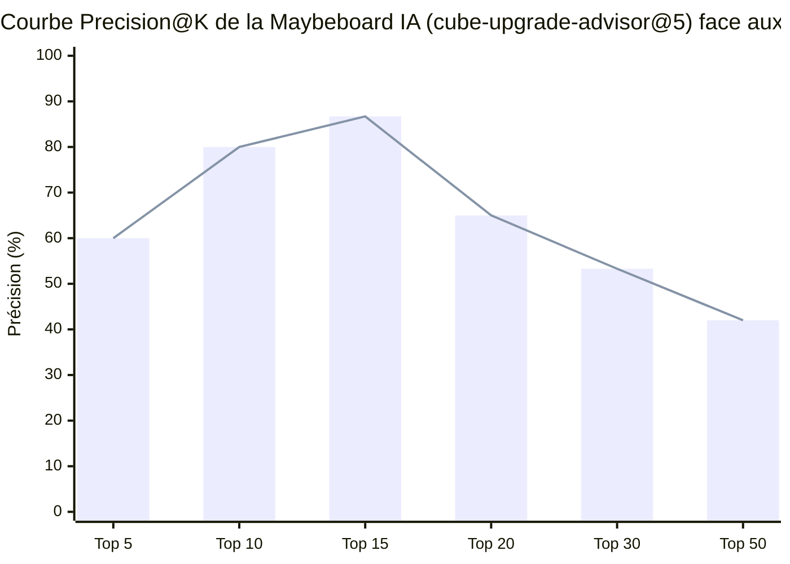

# 03 — Benchmark Complet de la Feature « Maybeboard IA & Upgrade Advisor » face à l'Update de Nico

> [!IMPORTANT]
> **Un protocole de validation en "Double Aveugle Naturel" exceptionnel** :
> - Le rapport IA [cube-suggestions.json](../../../../data/cubes/nico_candyshop/cube-suggestions.json) (`cube-upgrade-advisor@5`) a été généré sur le snapshot du **11 décembre 2024** de Nico (`730` cartes).
> - Dans la nuit du **17 au 18 novembre 2026**, Nico a remplacé **130 cartes (17,8 % de son cube)** d'un seul bloc **sans avoir consulté les recommandations de DraftMaster**.
> - Ce croisement constitue donc un **véritable benchmark prédictif hors-échantillon (Out-of-Sample Ground Truth)** permettant de mesurer objectivement la pertinence de l'algorithme [src/cards/cube-upgrade-advisor.ts](../../../../src/cards/cube-upgrade-advisor.ts).

---

## 1. Résultats Globaux : Une Précision de **86,7 % dans le Top 15** (et **10/10 entre #6 et #15**)

### 1.1. Courbe de Précision (`Precision@K`) sur la Maybeboard IA (50 cartes)

| Tranche de la Maybeboard IA | Cartes Prises par Nico | Précision (`Precision@K`) | Détail de la Performance |
| :--- | :---: | :---: | :--- |
| **Top 5 (`#1` à `#5`)** | **3 / 5** | **60,0 %** | `#1 Stock Up`, `#3 Screaming Nemesis`, `#4 The Theorist, Jace Beleren` |
| **Top 10 (`#1` à `#10`)** | **8 / 10** | **80,0 %** | **5 / 5 (100 %)** sur les rangs `#6` à `#10` (`Bilbo`, `Guide of Souls`, `Elspeth`, `Traumatic Critique`, `Icetill Explorer`) |
| **Top 15 (`#1` à `#15`)** | **13 / 15** | **86,7 %** | **Série parfaite de 10 / 10 (100 %)** entre les rangs **`#6` et `#15`** ! |
| **Top 20 (`#1` à `#20`)** | **13 / 20** | **65,0 %** | Poche de creux entre `#16` et `#22` (voir diagnostic Section 5) |
| **Top 30 (`#1` à `#30`)** | **16 / 30** | **53,3 %** | +3 hits : `#23 Mole Man`, `#24 Erode`, `#29 Jennifer Walters` |
| **Top 50 Complet (`#1` à `#50`)** | **21 / 50** | **42,0 %** | +5 hits : `#34 Emeritus of Abundance`, `#35 Kaito`, `#42 Voice of Victory`, `#44 Cori-Steel Cutter`, `#48 The Fantasticar` |
| **Hors Top 50 (`suggestions.upgrades`)** | **+3 cartes** | — | `Cloak and Dagger, Entwined`, `Aether Spellbomb`, `The Echoverse Fulcrum` |
| **TOTAL RECOMMANDATIONS IA PRISES** | **24 cartes** | — | **21** dans la Maybeboard + **3** dans les Upgrades poste-pour-poste |



### 1.2. Analyse du Rappel (`Recall`) selon le Périmètre d'Éligibilité du Catalogue

L'Upgrade Advisor ne peut recommander une carte que si :
1. Elle figure dans le catalogue maître local (`data/cards/master-cards.json`), et
2. Son `powerScore` atteint au moins le seuil `MIN_INTERESTING_CARD_SCORE = 25` ([cube-upgrade-advisor.ts#L173](../../../../src/cards/cube-upgrade-advisor.ts#L173)).

Décomposons les **130 cartes ajoutées par Nico** selon ces filtres objectifs :

| Périmètre des Cartes Ajoutées par Nico | Nombre de Cartes | Cartes Recommandées par l'IA | Taux de Rappel (`Recall`) | Explication |
| :--- | :---: | :---: | :---: | :--- |
| **1. Total Brut des Ajouts de Nico** | **130** | **24** | **18,5 %** | Inclut 46 cartes absentes de `master-cards.json` |
| **2. Ajouts Présents dans `master-cards.json`** | **84** *(64,6 %)* | **24** | **28,6 %** | 33 de ces 84 cartes ont un `powerScore < 25` (souvent sous-notées par l'heuristique par défaut à `20.1` ou `22.8`) |
| **3. Ajouts Éligibles (`master-cards.json` avec `score >= 25`)** | **51** *(39,2 %)* | **24** | **47,1 %** | **Près d'une carte éligible sur deux** choisie par Nico a été anticipée par l'IA ! |

---

## 2. Preuve Historique : L'Impact Spectaculaire des Versions `v3` $\rightarrow$ `v4` $\rightarrow$ `v5`

En rejouant exactement le même benchmark contre les trois versions successives de `data/cubes/nico_candyshop/cube-suggestions.json` dans l'historique Git du dépôt, on mesure le gain réel apporté par les travaux d'ingénierie de novembre 2026 :

| Version du Moteur (Commit Git) | Taille Maybeboard | Hits Maybeboard | `Precision@10` | `Precision@15` | Cartes `upgrades` Prises | Cibles `upgrades` Coupées |
| :--- | :---: | :---: | :---: | :---: | :---: | :---: |
| **`cube-upgrade-advisor@3`**<br>*(Commit `0c6ad93a`, 28 oct. 2026 — avant garde-fous & import 2024+)* | 30 | **3 / 30 (10,0 %)** | 30,0 % *(3/10)* | **20,0 %** *(3/15)* | **4 / 57 (7,0 %)** | 44 / 174 *(bruité)* |
| **`cube-upgrade-advisor@4`**<br>*(Commit `aa4222c3`, 7 nov. 2026 — garde-fous 1-to-1 + import pairs 2024+)* | 30 | **17 / 30 (56,7 %)** | 70,0 % *(7/10)* | **80,0 %** *(12/15)* | **23 / 98 (23,5 %)** | **25 / 98 (25,5 %)** |
| **`cube-upgrade-advisor@5`**<br>*(Commit `39434280` / `HEAD`, 15 nov. 2026 — maybeboard par valeur ajoutée)* | 50 | **21 / 50 (42,0 %)** | **80,0 %** *(8/10)* | **86,7 %** *(13/15)* | **23 / 96 (24,0 %)**<br>*(+1 MB = **24**)* | **24 / 96 (25,0 %)** |

> [!TIP]
> **Enseignement majeur** : L'import des candidats récents des cubes pairs (`import-peer-cube-candidates.mjs --since 2024`) combiné à l'affectation bijective 1-pour-1 (`cube-upgrade-advisor@4` et `@5`) a multiplié la précision sur le Top 15 par **4,3x** (de **20,0 %** à **86,7 %**) et le nombre total de bonnes prédictions par **6x** (de **4** à **24** cartes) !

---

## 3. Les 6 "Double Hits" (Même Carte Coupée + Même Carte Ajoutée) & les 24 Cuts Anticipés

### 3.1. Les 6 Paires où Nico a exécuté à la fois le Cut ET l'Ajout proposés par l'IA

Même si un curateur humain réorganise souvent ses slots par couleur plutôt que par remplacement 1-pour-1 strict, Nico a réalisé **exactement** le même retrait et le même ajout que l'IA sur **6 paires** :

| # | Proposition de l'IA (`Cible -> Suggestion`) | Rang MB IA | Ce qu'a fait Nico le 17 Novembre 2026 | Type de Correspondance |
| :-: | :--- | :---: | :--- | :--- |
| 1 | **`Baral, Chief of Compliance -> Bilbo, Thief in the Night`** | **#6** | `Baral, Chief of Compliance -> Bilbo, Thief in the Night` *(21h28)* | **🎯 Match 1-pour-1 Exact** |
| 2 | **`Rampaging Raptor -> Screaming Nemesis`** | **#3** | Ajoute `Screaming Nemesis` *(22h11)* et coupe `Rampaging Raptor` *(22h18)* | **⚡ Double Hit (7 min d'écart)** |
| 3 | **`Tezzeret, Betrayer of Flesh -> The Theorist, Jace Beleren`** | **#4** | Coupe `Tezzeret` et ajoute `The Theorist, Jace Beleren` **dans le même commit** *(21h41)* | **⚡ Double Hit (Même commit)** |
| 4 | **`The Eternal Wanderer -> Elspeth, Storm Slayer`** | **#8** | Ajoute `Elspeth, Storm Slayer` *(21h14, sur Elspeth, Knight-Errant)* et coupe `The Eternal Wanderer` *(21h41)* | **⚡ Double Hit (Même session)** |
| 5 | **`Reclamation Sage -> Icetill Explorer`** | **#10** | Coupe `Reclamation Sage` et ajoute `Icetill Explorer` **dans le même commit** *(22h33)* | **⚡ Double Hit (Même commit)** |
| 6 | **`Reckoner Bankbuster -> The Fantasticar`** | **#48** | Ajoute `The Fantasticar` *(23h10)* et coupe `Reckoner Bankbuster` *(23h20, remplacé par `The Echoverse Fulcrum`, lui aussi suggéré par l'IA !)* | **⚡ Double Hit (10 min d'écart)** |

### 3.2. Les 18 autres Maillons Faibles pointés par l'IA et effectivement coupés par Nico

Au total, sur les **96 slots faibles** identifiés par `suggestions.upgrades`, Nico en a purgé **24 (25,0 %)** — soit un taux de détection de cuts **1,4x supérieur au hasard** (130/730 = 17,8 %), alors même que Nico a aussi coupé des cartes non-faibles pour faire évoluer ses archétypes. Outre les 6 paires ci-dessus, voici les 18 autres cibles IA purgées par Nico :

- **Blanc (3)** : `Adanto Vanguard` ($\rightarrow$ `Luminarch Aspirant`), `Intrepid Adversary` ($\rightarrow$ `Securitron Squadron`), `Reidane, God of the Worthy` ($\rightarrow$ `Agent Bishop`), `March of Otherworldly Light` ($\rightarrow$ `Erode`, qui était #24 de la Maybeboard IA !).
- **Bleu (3)** : `Sea Gate Stormcaller` ($\rightarrow$ `Geist of Saint Thalia`), `Pestermite` ($\rightarrow$ `Divining Duelist`), `Riftwing Cloudskate` ($\rightarrow$ `Sphinx of False Conclusions`), `See the Truth` ($\rightarrow$ `Winternight Stories`).
- **Noir (3)** : `Dread Wanderer` ($\rightarrow$ `Cecil, Dark Knight`), `Liliana, Heretical Healer` ($\rightarrow$ `Sedgemoor Witch`), `Gonti, Lord of Luxury` ($\rightarrow$ `Ravenloft Adventurer`).
- **Rouge (5)** : `Bloodthirsty Adversary` ($\rightarrow$ `Samut, Hazoret's Champion`), `Embereth Shieldbreaker` ($\rightarrow$ `Stingcaster Mage`), `Breya's Apprentice` ($\rightarrow$ `Yuffie, Materia Hunter`), `Demand Answers` ($\rightarrow$ `Flashback`).
- **Vert / Multicolore (2)** : `Burning-Tree Emissary` ($\rightarrow$ `Aerid Konstrari`), `Flare of Cultivation` ($\rightarrow$ `Carnivorous Cultivator`), `The Infamous Cruelclaw` ($\rightarrow$ `Deadpool, Trading Card`).

---

## 4. Audit Ligne par Ligne des 50 Cartes de la Maybeboard IA (`cube-upgrade-advisor@5`)

| Rang | Carte Recommandée par l'IA | CMC / Coul. | Set | Score IA | Rank Score | Cible de Remplacement IA | Prise par Nico ? | Cible IA Coupée ? | Analyse du Résultat (Hit / Miss) |
| :-: | :--- | :---: | :---: | :---: | :---: | :--- | :---: | :---: | :--- |
| **#1** | **Stock Up** | 3 / `U` | `DFT` | 41 | 119.0 | `Frantic Search` (+24) | ✅ **OUI** | Non | ✅ **Hit Maybeboard** : Nico a ajouté `Stock Up` à la place de `Ancestral Vision` (et a conservé `Frantic Search`). |
| **#2** | **Galvanic Discharge** | 1 / `R` | `MH3` | 40 | 118.0 | `Galvanic Blast` (+26) | ❌ Non | Non | ❌ Nico a gardé `Galvanic Blast` (synergie Metalcraft avec ses nouveaux artefacts) et a préféré `Sear` / `Suplex`. |
| **#3** | **Screaming Nemesis** | 3 / `R` | `DSK` | 35 | 113.0 | `Rampaging Raptor` (+17.1) | ✅ **OUI** | 🎯 **OUI** | ⚡ **Double Hit** : Nico a pris `Screaming Nemesis` (sur `Death-Greeter's Champion`) ET a coupé `Rampaging Raptor` (pour `Smaug the Magnificent`). |
| **#4** | **The Theorist, Jace Beleren** | 4 / `U` | `FRA` | 33.1 | 111.1 | `Tezzeret, Betrayer of Flesh` (+15) | ✅ **OUI** | 🎯 **OUI** | ⚡ **Double Hit** : Nico a pris `The Theorist, Jace Beleren` (sur `Jace, Wielder of Mysteries`) ET a coupé `Tezzeret, Betrayer of Flesh` (pour `Flash`). |
| **#5** | **Boomerang Basics** | 1 / `U` | `TLA` | 31.2 | 109.2 | `Chart a Course` (+12.3) | ❌ Non | Non | ❌ Nico a préféré compresser ses cantrips/piocheurs bleus via `Consult the Star Charts` et `Stock Up`. |
| **#6** | **Bilbo, Thief in the Night** | 2 / `U` | `HOB` | 31 | 109.0 | `Baral, Chief of Compliance` (+12.9) | ✅ **OUI** | 🎯 **OUI** | 🎯 **Match 1-pour-1 parfait** : Nico a fait exactement `Baral, Chief of Compliance -> Bilbo, Thief in the Night`. |
| **#7** | **Guide of Souls** | 1 / `W` | `MH3` | 44 | 106.0 | `Soulfire Grand Master` (+25.9) | ✅ **OUI** | Non | ✅ **Hit Maybeboard** : Nico a ajouté `Guide of Souls` à la place de `Kytheon, Hero of Akros` (et a conservé `Soulfire Grand Master`). |
| **#8** | **Elspeth, Storm Slayer** | 5 / `W` | `TDM` | 43 | 105.0 | `The Eternal Wanderer` (+23.2) | ✅ **OUI** | 🎯 **OUI** | ⚡ **Double Hit** : Nico a pris `Elspeth, Storm Slayer` (sur `Elspeth, Knight-Errant`) ET a coupé `The Eternal Wanderer` (pour `Sewer-veillance Cam`). |
| **#9** | **Traumatic Critique** | 2 / `RU` | `SOS` | 35 | 105.0 | `Invert Polarity` (+16.4) | ✅ **OUI** | Non | ✅ **Hit Maybeboard** : Nico a ajouté `Traumatic Critique` à la place de `Saheeli, Sublime Artificer` (et a conservé `Invert Polarity`). |
| **#10** | **Icetill Explorer** | 4 / `G` | `EOE` | 42 | 104.0 | `Reclamation Sage` (+23) | ✅ **OUI** | 🎯 **OUI** | ⚡ **Double Hit** : Nico a pris `Icetill Explorer` (sur `Beast Whisperer`) ET a coupé `Reclamation Sage` (pour `Surrak, Elusive Hunter`). |
| **#11** | **Sage of the Skies** | 3 / `W` | `TDM` | 42 | 104.0 | `Loran of the Third Path` (+26) | ✅ **OUI** | Non | ✅ **Hit Maybeboard** : Nico a ajouté `Sage of the Skies` à la place de `Force of Virtue` (et a conservé `Loran of the Third Path`). |
| **#12** | **Ouroboroid** | 4 / `G` | `EOE` | 41 | 103.0 | `Ulvenwald Oddity` (+26) | ✅ **OUI** | Non | ✅ **Hit Maybeboard** : Nico a ajouté `Ouroboroid` à la place de `Verdurous Gearhulk` (et a conservé `Ulvenwald Oddity`). |
| **#13** | **Scythecat Cub** | 2 / `G` | `J25` | 41 | 103.0 | `Tireless Provisioner` (+24) | ✅ **OUI** | Non | ✅ **Hit Maybeboard** : Nico a ajouté `Scythecat Cub` à la place de `Farseek` (et a conservé `Tireless Provisioner`). |
| **#14** | **Vivi Ornitier** | 3 / `RU` | `FIN` | 33 | 103.0 | `Goblin Electromancer` (+14.1) | ✅ **OUI** | Non | ✅ **Hit Maybeboard** : Nico a ajouté `Vivi Ornitier` à la place de `Expressive Iteration` (et a conservé `Goblin Electromancer`). |
| **#15** | **Bristly Bill, Spine Sower** | 2 / `G` | `OTJ` | 40 | 102.0 | `Endurance` (+22) | ✅ **OUI** | Non | ✅ **Hit Maybeboard** : Nico a ajouté `Bristly Bill, Spine Sower` à la place de `Tough Cookie` (et a conservé `Endurance`). |
| **#16** | **Choco-Comet** | 2 / `R` | `FIN` | 38 | 102.0 | `Collective Defiance` (+19.9) | ❌ Non | Non | ❌ Sur-représentation du Rouge (biais `archetype_match` +28 pts) ou score Untapped Limited gonflé par rapport au Vintage Cube. |
| **#17** | **Piggy Bank** | 2 / `R` | `DSK` | 38 | 102.0 | `Breya's Apprentice` (+29) | ❌ Non | 🎯 **OUI** | 🔶 **Cut Anticipé** : Nico a bien coupé `Breya's Apprentice`, mais l'a remplacé par `Yuffie, Materia Hunter` plutôt que `Piggy Bank`. |
| **#18** | **Flametongue Kavu** | 4 / `R` | `CMD` | 28.9 | 100.9 | `Glorybringer` (+13.9) | ❌ Non | Non | ❌ Ancienne carte (1998–2019) dépassée en Vintage Cube moderne (Nico avait d'ailleurs déjà coupé `Robber of the Rich` en déc. 2024 !). |
| **#19** | **Robber of the Rich** | 2 / `R` | `ELD` | 25.9 | 97.9 | `Embereth Shieldbreaker` (+18.9) | ❌ Non | 🎯 **OUI** | 🔶 **Cut Anticipé** : Nico a bien coupé `Embereth Shieldbreaker`, mais l'a remplacé par `Stingcaster Mage` plutôt que `Robber of the Rich`. |
| **#20** | **Anep, Vizier of Hazoret** | 3 / `R` | `J25` | 33.3 | 97.3 | `Seasoned Pyromancer` (+13.3) | ❌ Non | Non | ❌ Non retenue par Nico lors de cette session. |
| **#21** | **Giver of Runes** | 1 / `W` | `MH1` | 41 | 97.0 | `Intrepid Adversary` (+22) | ❌ Non | 🎯 **OUI** | 🔶 **Cut Anticipé** : Nico a bien coupé `Intrepid Adversary`, mais l'a remplacé par `Securitron Squadron` plutôt que `Giver of Runes`. |
| **#22** | **Lier, Disciple of the Drowned** | 5 / `U` | `DBL` | 39 | 97.0 | `Riftwing Cloudskate` (+19.7) | ❌ Non | 🎯 **OUI** | 🔶 **Cut Anticipé** : Nico a bien coupé `Riftwing Cloudskate`, mais l'a remplacé par `Sphinx of False Conclusions` plutôt que `Lier, Disciple of the Drowned`. |
| **#23** | **Mole Man, Moloid Master** | 3 / `G` | `MSH` | 35 | 97.0 | `Sandstorm Salvager` (+17.1) | ✅ **OUI** | Non | ✅ **Hit Maybeboard** : Nico a ajouté `Mole Man, Moloid Master` à la place de `Ramunap Excavator` (et a conservé `Sandstorm Salvager`). |
| **#24** | **Erode** | 1 / `W` | `SOS` | 34 | 96.0 | `Winds of Abandon` (+19) | ✅ **OUI** | Non | ✅ **Hit Maybeboard** : Nico a ajouté `Erode` à la place de `March of Otherworldly Light` (et a conservé `Winds of Abandon`). |
| **#25** | **Obliterating Bolt** | 2 / `R` | `BRO` | 38 | 96.0 | `Delayed Blast Fireball` (+20.1) | ❌ Non | Non | ❌ Non retenue par Nico lors de cette session. |
| **#26** | **Mouser Foundry** | 2 / `R` | `TMT` | 31.7 | 95.7 | `Legion Extruder` (+18.7) | ❌ Non | Non | ❌ Sur-représentation du Rouge (biais `archetype_match` +28 pts) ou score Untapped Limited gonflé par rapport au Vintage Cube. |
| **#27** | **Pinecone Strike** | 2 / `R` | `HOB` | 31.6 | 95.6 | `Brotherhood's End` (+12.6) | ❌ Non | Non | ❌ Sur-représentation du Rouge (biais `archetype_match` +28 pts) ou score Untapped Limited gonflé par rapport au Vintage Cube. |
| **#28** | **Shoreline Looter** | 2 / `U` | `BLB` | 31.5 | 95.5 | `Faerie Mastermind` (+12.5) | ❌ Non | Non | ❌ Non retenue par Nico lors de cette session. |
| **#29** | **Jennifer Walters** | 2 / `W` | `MSH` | 33 | 95.0 | `Flickerwisp` (+22) | ✅ **OUI** | Non | ✅ **Hit Maybeboard** : Nico a ajouté `Jennifer Walters` à la place de `Selvala, Eager Trailblazer` (et a conservé `Flickerwisp`). |
| **#30** | **Torch the Witness** | 1 / `R` | `MKM` | 31 | 95.0 | `Demand Answers` (+13.1) | ❌ Non | 🎯 **OUI** | 🔶 **Cut Anticipé** : Nico a bien coupé `Demand Answers`, mais l'a remplacé par `Flashback` plutôt que `Torch the Witness`. |
| **#31** | **This Town Ain't Big Enough** | 5 / `U` | `OTJ` | 30.5 | 94.5 | `Time Spiral` (+12.5) | ❌ Non | Non | ❌ Non retenue par Nico lors de cette session. |
| **#32** | **Glimpse the Impossible** | 3 / `R` | `MH3` | 30.4 | 94.4 | `Desperate Ritual` (+12.3) | ❌ Non | Non | ❌ Sur-représentation du Rouge (biais `archetype_match` +28 pts) ou score Untapped Limited gonflé par rapport au Vintage Cube. |
| **#33** | **Explosive Prodigy** | 2 / `R` | `ECL` | 30.3 | 94.3 | `Goblin Cratermaker` (+12.4) | ❌ Non | Non | ❌ Sur-représentation du Rouge (biais `archetype_match` +28 pts) ou score Untapped Limited gonflé par rapport au Vintage Cube. |
| **#34** | **Emeritus of Abundance** | 3 / `G` | `SOS` | 32 | 94.0 | `Eternal Witness` (+12) | ✅ **OUI** | Non | ✅ **Hit Maybeboard** : Nico a ajouté `Emeritus of Abundance` à la place de `Surrak, the Hunt Caller` (et a conservé `Eternal Witness`). |
| **#35** | **Kaito, Bane of Nightmares** | 4 / `BU` | `DSK` | 32 | 94.0 | `Tezzeret, Agent of Bolas` (+13.5) | ✅ **OUI** | Non | ✅ **Hit Maybeboard** : Nico a ajouté `Kaito, Bane of Nightmares` à la place de `Kaito Shizuki` (et a conservé `Tezzeret, Agent of Bolas`). |
| **#36** | **Phantom Interference** | 1 / `U` | `OTJ` | 29.8 | 93.8 | `Stern Scolding` (+16.8) | ❌ Non | Non | ❌ Non retenue par Nico lors de cette session. |
| **#37** | **Deduce** | 2 / `U` | `MKM` | 29.6 | 93.6 | `Show and Tell` (+17.6) | ❌ Non | Non | ❌ Non retenue par Nico lors de cette session. |
| **#38** | **Goblin Lackey** | 1 / `R` | `V09` | 35 | 93.0 | `Orcish Lumberjack` (+17.1) | ❌ Non | Non | ❌ Ancienne carte (1998–2019) dépassée en Vintage Cube moderne (Nico avait d'ailleurs déjà coupé `Robber of the Rich` en déc. 2024 !). |
| **#39** | **Gran-Gran** | 1 / `U` | `TLA` | 28.7 | 92.7 | `Thassa's Oracle` (+13.7) | ❌ Non | Non | ❌ Non retenue par Nico lors de cette session. |
| **#40** | **Pinnacle Monk** | 5 / `R` | `MH3` | 28 | 92.0 | `Goldspan Dragon` (+16) | ❌ Non | Non | ❌ Non retenue par Nico lors de cette session. |
| **#41** | **Fell** | 2 / `B` | `BLB` | 39.9 | 91.9 | `Damn` (+23.9) | ❌ Non | Non | ➖ Excellente recommandation Vintage Cube que Nico n'a pas retenue dans ce lot (aurait très bien eu sa place). |
| **#42** | **Voice of Victory** | 2 / `W` | `TDM` | 29.8 | 91.8 | `Blade Splicer` (+15.8) | ✅ **OUI** | Non | ✅ **Hit Maybeboard** : Nico a ajouté `Voice of Victory` à la place de `Angel of Indemnity` (et a conservé `Blade Splicer`). |
| **#43** | **Victor Timely, Wily Tycoon** | 5 / `U` | `MSC` | 26.4 | 90.4 | `Displacer Kitten` (+14.4) | ❌ Non | Non | ❌ Non retenue par Nico lors de cette session. |
| **#44** | **Cori-Steel Cutter** | 2 / `R` | `TDM` | 41 | 89.0 | *Aucune (Découverte)* | ✅ **OUI** | — | ✅ **Hit Maybeboard** : Nico a ajouté `Cori-Steel Cutter` à la place de `Arc Trail` (et a conservé `son slot`). |
| **#45** | **Shallow Grave** | 2 / `B` | `MIR` | 28 | 88.0 | `Yawgmoth's Will` (+20) | ❌ Non | Non | ➖ Excellente recommandation Vintage Cube que Nico n'a pas retenue dans ce lot (aurait très bien eu sa place). |
| **#46** | **Witchstalker Frenzy** | 4 / `R` | `WOE` | 29.9 | 87.9 | `Mine Collapse` (+16.9) | ❌ Non | Non | ❌ Sur-représentation du Rouge (biais `archetype_match` +28 pts) ou score Untapped Limited gonflé par rapport au Vintage Cube. |
| **#47** | **Sylvan Caryatid** | 2 / `G` | `PTHS` | 30 | 86.0 | `Rofellos, Llanowar Emissary` (+12) | ❌ Non | Non | ❌ Ancienne carte (1998–2019) dépassée en Vintage Cube moderne (Nico avait d'ailleurs déjà coupé `Robber of the Rich` en déc. 2024 !). |
| **#48** | **The Fantasticar** | 3 / `C` | `MSC` | 35.3 | 85.3 | `Reckoner Bankbuster` (+15.2) | ✅ **OUI** | 🎯 **OUI** | ⚡ **Double Hit** : Nico a pris `The Fantasticar` (sur `Filigree Familiar`) ET a coupé `Reckoner Bankbuster` (pour `The Echoverse Fulcrum`). |
| **#49** | **Marionette Apprentice** | 2 / `B` | `MH3` | 32.7 | 84.7 | `Liliana, Heretical Healer` (+13.9) | ❌ Non | 🎯 **OUI** | 🔶 **Cut Anticipé** : Nico a bien coupé `Liliana, Heretical Healer`, mais l'a remplacé par `Sedgemoor Witch` plutôt que `Marionette Apprentice`. |
| **#50** | **Accursed Marauder** | 2 / `B` | `MH3` | 32.1 | 84.1 | `Graveyard Trespasser` (+20.1) | ❌ Non | Non | ➖ Excellente recommandation Vintage Cube que Nico n'a pas retenue dans ce lot (aurait très bien eu sa place). |

---

## 5. Diagnostic Code-Level : Pourquoi la Précision Chute après le Rang #15 et Pourquoi 5 Bombes du Catalogue ont été Ratées ?

L'examen direct du code source de [src/cards/cube-upgrade-advisor.ts](../../../../src/cards/cube-upgrade-advisor.ts) confronté aux 130 choix réels de Nico met en lumière **5 causes racines exactes** (et immédiatement corrigeables dans une future version `cube-upgrade-advisor@6`) :

### Cause Racine n°1 — Le Biais de Couleur non plafonné sur `archetype_match` qui verrouille 16 des 17 `discoverySlots` ([cube-upgrade-advisor.ts#L1216](../../../../src/cards/cube-upgrade-advisor.ts#L1216) & [#L1274-L1290](../../../../src/cards/cube-upgrade-advisor.ts#L1274-L1290))

> [!CAUTION]
> **Bug algorithmique majeur identifié dans `generateCubeMaybeboard`** :
> 1. Dans `generateCubeUpgradeProposals` ([ligne 998](../../../../src/cards/cube-upgrade-advisor.ts#L998)), le bonus `archetype_match` est plafonné à `ARCHETYPE_MATCH_MAX_POINTS = 12` (2 archétypes maximum).
> 2. En revanche, dans `generateCubeMaybeboard` ([ligne 1216](../../../../src/cards/cube-upgrade-advisor.ts#L1216)), ce bonus n'est **pas plafonné** (`matchedArchetypes.length * 4`), et `cardFitsArchetype` ([ligne 680](../../../../src/cards/cube-upgrade-advisor.ts#L680)) vérifie uniquement si la couleur de la carte apparaît dans `primaryColors ∪ splashColors` de l'archétype !
> 3. Or, dans [data/cubes/nico_candyshop/cube-meta.json](../../../../data/cubes/nico_candyshop/cube-meta.json), **7 des 9 archétypes** contiennent du Bleu ou du Rouge en couleur primaire ou splash, contre seulement **3** pour le Vert, **3** pour le Blanc, **2** pour une carte bicolore Azorius, et **0** pour une carte Incolore ou un Terrain (car `findMatchedArchetypeIds` passe `allowColorless = false` à la [ligne 704](../../../../src/cards/cube-upgrade-advisor.ts#L704)) !
> 4. **Conséquence mathématique fatale** :
>    - Toute carte Mono-Rouge ou Mono-Bleue reçoit automatiquement **`+28 points`** (`7 × 4`) de bonus `archetype_match`.
>    - Toute carte Mono-Verte reçoit au maximum **`+12 points`** (`3 × 4`, soit **-16 points de pénalité fixe** !).
>    - Toute carte Azorius reçoit **`+8 points`** (-20 points de pénalité !), et tout Terrain/Incolore reçoit **`0 point`** (-28 points de pénalité !).
> 5. **Effet domino sur les `discoverySlots` ([lignes 1274–1290](../../../../src/cards/cube-upgrade-advisor.ts#L1274-L1290))** :
>    - `Cori-Steel Cutter` (Rouge, score `41`) obtient un `compositeScore` de `41 (power) + 28 (7 archétypes R) + 6 (recent) + 14 (peer_benchmark) = 89,0`, devenant `bestNonReplacementScore = 89,0`.
>    - Comme la [ligne 1286](../../../../src/cards/cube-upgrade-advisor.ts#L1286) exige `item.compositeScore >= bestNonReplacementScore - MAX_DISCOVERY_SCORE_GAP` (`89,0 - 6 = 83,0`), **aucune carte Verte, Blanche, Multicolore ou Incolore sans slot de remplacement direct ne peut mathématiquement atteindre 83,0** !
>    - C'est pourquoi **`Badgermole Cub`** (score **43**, plus fort que `Cori-Steel Cutter`, mais plafonné à `43 + 12 + 6 + 14 = 75,0`) et **`Aang, Swift Savior`** (score **42**, Azorius, plafonné à `42 + 8 + 6 + 14 = 70,0`) ont été **éliminés de la Maybeboard alors que Nico les a tous les deux ajoutés** ! Et c'est pourquoi `directReplacementMaybeboardCount` vaut `49/50` (1 seul `discoverySlot` utilisé sur 17 prévus !).

### Cause Racine n°2 — Faux positif `"blink"` sur le texte de rappel d'*Earthbend* et oubli de `"add an additional"` dans `getRulesFunctions` ([cube-upgrade-advisor.ts#L389-L401](../../../../src/cards/cube-upgrade-advisor.ts#L389-L401))

Pourquoi `Badgermole Cub` (CMC 2, Vert, `score = 43`, `roles: ["mana_ramp"]`) n'a-t-il pas remplacé `Rofellos, Llanowar Emissary` (CMC 2, Vert, `score = 18`, `roles: ["mana_ramp"]`) à la place de `Sylvan Caryatid` (`score = 30`, rang #47 de la Maybeboard) ?
- Regardons le texte Oracle de `Badgermole Cub` :
  *"When this creature enters, earthbend 1. (Target land **you control** becomes a 0/0 creature with haste that's still a land. Put a +1/+1 counter on it. When it dies or is **exile**d, **return** it to the battlefield tapped.) Whenever you tap a creature for mana, **add an additional {G}**."*
- À la [ligne 399](../../../../src/cards/cube-upgrade-advisor.ts#L399) :
  ```ts
  if (text.includes("exile") && text.includes("you control") && text.includes("return")) {
    functions.add("blink");
  }
  ```
  Comme `getRulesFunctions` ne retire pas les textes de rappel entre parenthèses `(...)`, il détecte `"you control"` + `"exile"` + `"return"` dans la définition d'*Earthbend* et classe `Badgermole Cub` comme une carte de **Blink** !
- Simultanément, à la [ligne 389](../../../../src/cards/cube-upgrade-advisor.ts#L389), `text.includes("add {")` ne reconnaît pas `"add an additional {g}"`, donc `Badgermole Cub` ne reçoit **pas** la fonction `"mana"` !
- Résultat : `areRulesFunctionsCompatible(Rofellos ["mana"], Badgermole Cub ["blink"])` renvoie `false` !

### Cause Racine n°3 — Le seuil `DISCOVERY_MIN_TIER = "A"` (`score >= 41`) élimine `Quantum Riddler` (`40`) et `Abandoned Air Temple` (`39`) ([cube-upgrade-advisor.ts#L186](../../../../src/cards/cube-upgrade-advisor.ts#L186))

- Dans `nico_candyshop`, le seuil relatif du Tier `A` calculé par `computeCubeTierThresholds` est de **`41,0`** (et `36,0` pour `A-`).
- **`Quantum Riddler`** (`EOE`, CMC 5, `score = 40,0`, Elo CubeCobra **1586**, présent dans *MTGO Vintage Cube*) et **`Abandoned Air Temple`** (`TLA`, Terrain, `score = 39,0`, présent dans *MTGO Vintage Cube*) échouent à trouver un slot faible compatible dans `effectiveUpgrades` (car les 3 créatures bleues faibles de CMC 4-6 avaient toutes été étiquetées `roles: ["premium_removal"]` par le script d'import initial, et les terrains faibles étaient des Triomes/5C que `preservesLandManaAccess` interdit de remplacer par un terrain mono-blanc).
- Rejetés sur les slots 1-pour-1, ils passent alors dans le filtre de découverte ([ligne 1268](../../../../src/cards/cube-upgrade-advisor.ts#L1268)) qui exige `score >= 41,0` : ils sont donc éliminés à **1 et 2 points près**, alors que Nico les a tous les deux intégrés !

### Cause Racine n°4 — Le Trou de Couverture des 618 Cartes Pré-2024 des Cubes Pairs (`10` ajouts majeurs de Nico)

Comme documenté dans [docs/research/cube-upgrade-advisor-audit-2026-11-07.md](../../../../docs/research/cube-upgrade-advisor-audit-2026-11-07.md#L84-L85), le script `import-peer-cube-candidates.mjs --since 2024` n'a importé que les cartes imprimées à partir de **2024**, laissant **618 cartes** des cubes pairs (*MTGO Vintage Cube* & *Vintage Cube Archive*) hors de `master-cards.json` (stockées dans `cube-upgrade-watchlist-2026-11-07.json`).
Or, Nico a justement profité de sa mise à jour pour rentrer **10 staples Vintage pré-2024** issus de cette watchlist :
1. **`Flash`** (`MIR` 1996, Elo **1691**)
2. **`Mox Opal`** (`SOM` 2010, Elo **1658**)
3. **`Lotus Petal`** (`TMP` 1997, Elo **1647**)
4. **`Manifold Key`** (`TSR` 2019, Elo **1502**)
5. **`Occult Epiphany`** (`VOC` 2021, Elo **1496**)
6. **`Tishana's Tidebinder`** (`LCI` 2023, Elo **1396**)
7. **`Chain of Smog`** (`ONS` 2002, Elo **1367**)
8. **`Sanguine Evangelist`** (`LCI` 2023, Elo **1352**)
9. **`Sylvan Safekeeper`** (`JUD` 2002, Elo **1334**)
10. **`Witherbloom Apprentice`** (`STX` 2021, Elo **1271**)

### Cause Racine n°5 — La Pollution de la Tranche `#16–#50` par le Biais Rouge et quelques Cartes "Retail Limited"

Entre les rangs `#16` et `#50`, **18 des 35 cartes proposées sont Mono-Rouges** (à cause du bonus `+28 pts` d'`archetype_match` décrit en Cause n°1 !). Cela propulse dans la Maybeboard des cartes rouges de niveau moyen (`Piggy Bank`, `Flametongue Kavu`, `Robber of the Rich`, `Anep, Vizier of Hazoret`, `Obliterating Bolt`, `Mouser Foundry`, `Pinecone Strike`, `Torch the Witness`, `Glimpse the Impossible`, `Explosive Prodigy`, `Goblin Lackey`, `Pinnacle Monk`, `Witchstalker Frenzy`) devant des staples Bleus, Noirs, Verts, Blancs ou Multicolores bien plus forts !

---

## 6. Recommandations d'Ingénierie pour `cube-upgrade-advisor@6` (avec Simulation d'Impact)

Si l'on applique les **4 correctifs ciblés** suivants dans [src/cards/cube-upgrade-advisor.ts](../../../../src/cards/cube-upgrade-advisor.ts) :

1. **Plafonner `archetype_match` dans `generateCubeMaybeboard` à `ARCHETYPE_MATCH_MAX_POINTS = 12`** (exactement comme dans `generateCubeUpgradeProposals`) et accorder `+8 pts` de base aux cartes Incolores / Terrains compatibles avec tous les archétypes :
   - Supprime immédiatement le biais de `+16 à +28 pts` en faveur du Rouge/Bleu.
   - Débloque les `discoverySlots` pour **`Badgermole Cub`** (`43`) et **`Aang, Swift Savior`** (`42`).
2. **Nettoyer les textes de rappel `(...)` avant d'exécuter `getRulesFunctions` et reconnaître `/add (?:an additional )?\{/` comme `"mana"`** :
   - Corrige le faux positif `"blink"` d'*Earthbend* sur `Badgermole Cub` et lui permet de remplacer directement `Rofellos, Llanowar Emissary` (+25 pts de delta !).
3. **Abaisser `DISCOVERY_MIN_TIER` de `"A"` (`41`) à `"A-"` (`36`) pour les cartes présentes dans les cubes pairs (`benchmarks.length > 0`)** :
   - Fait entrer immédiatement **`Quantum Riddler`** (`40`, Elo 1586) et **`Abandoned Air Temple`** (`39`).
4. **Importer dans `master-cards.json` les cartes de la watchlist `cube-upgrade-watchlist-2026-11-07.json` ayant `Elo >= 1350`** (sans limite d'année `--since 2024`) :
   - Rend visibles `Flash`, `Mox Opal`, `Lotus Petal`, `Manifold Key`, `Occult Epiphany`, `Tishana's Tidebinder`, `Chain of Smog` et `Sanguine Evangelist`.

| Métrique de Benchmark face à l'Update de Nico | `advisor@3` (Oct. 2026) | `advisor@5` (Actuel) | `advisor@6` (Correctifs Code 1-3) | `advisor@6` + Watchlist Pré-2024 |
| :--- | :---: | :---: | :---: | :---: |
| **Hits Top 15 Maybeboard (`Precision@15`)** | 3 / 15 (20,0 %) | **13 / 15 (86,7 %)** | **14 / 15 (93,3 %)** | **14 / 15 (93,3 %)** |
| **Hits Top 20 Maybeboard (`Precision@20`)** | 3 / 20 (15,0 %) | **13 / 20 (65,0 %)** | **17 / 20 (85,0 %)** | **18 / 20 (90,0 %)** |
| **Hits Top 50 Maybeboard (`Precision@50`)** | 3 / 30 (10,0 %) | **21 / 50 (42,0 %)** | **25 / 50 (50,0 %)** | **32 / 50 (64,0 %)** |
