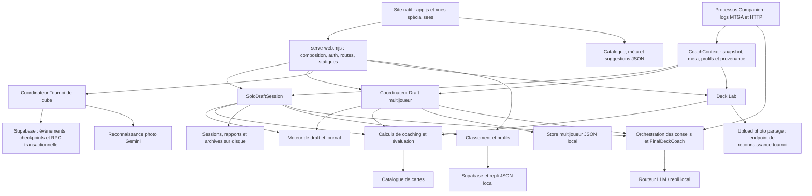

# Audit de l’architecture du site et de sa stratégie de tests

Date : 28 septembre 2026. Dépôt : `E:/SecondBrain/DraftMaster`. Branche examinée : `codex/011-photo-ocr-grounding`. HEAD : `828bcf9b7479c88cedd95620e211ee3338bc48de`.

## Diagnostic

DraftMaster est un **monolithe modulaire** : un site en HTML/CSS/JavaScript natif, un serveur HTTP Node et plusieurs modules TypeScript. Le moteur de draft et les calculs du coaching sont bien isolés et disposent de preuves comportementales solides. Les principales faiblesses se situent dans le routage statique, la reprise Solo, la publication des résultats, les adaptateurs cloud et les interfaces du navigateur.

Les tests passent sur le périmètre exécuté, mais cette réussite ne démontre pas la sûreté de toutes les interfaces : deux sondes locales reproduisent des défauts que la suite actuelle ne détecte pas. La priorité est de sécuriser ces interfaces avec des régressions ciblées, puis de répartir les responsabilités du serveur et du navigateur. Aucun changement de framework ni découpage en microservices n’est justifié par cet audit.

L’audit ajoute uniquement ce rapport et ses preuves JSON. Aucun code produit ni test existant n’a été modifié ; les tests proposés ci-dessous restent à implémenter. Les fichiers non suivis présents avant l’audit ont été préservés.

## Périmètre et méthode

- Lecture des règles du dépôt, de `CONTEXT.md`, de la constitution, des configurations QA/CI, des interfaces et implémentations représentatives et des tests de chaque domaine.
- Inventaire des imports/exports locaux par l’AST TypeScript, en distinguant les imports de types des dépendances d’exécution. Recherche de cycles au niveau des fichiers.
- Exécution de la suite Vitest avec couverture, de Chromium, des benchmarks isolés et des vérifications statiques/de données.
- Deux sondes locales : lecture d’un marqueur inoffensif hors des racines publiques et restauration Solo en mémoire. Aucun secret lu, aucune requête sur le site déployé, aucune session utilisateur modifiée.

Les imports directs des tests indiquent une relation technique ; ils ne prouvent ni la couverture d’un comportement ni son adéquation à une exigence. Les imports calculés, dépendances via fichiers JSON, SQL, DOM, événements et appels HTTP ne sont pas tous représentés par le graphe statique. La taille des fichiers sert à repérer les responsabilités à examiner, pas à mesurer la qualité d’un module.

Preuves conservées :

- [Inventaire des modules, fichiers, imports et tests](artifacts/site-architecture-inventory-2026-09-28.json).
- [Résultats et couverture par module](artifacts/site-architecture-test-evidence-2026-09-28.json).
- [Sonde du routage statique](artifacts/site-static-routing-probe-2026-09-28.json).
- [Sonde de reprise Solo](artifacts/site-solo-restore-probe-2026-09-28.json).

## Architecture effectivement branchée

Le Companion est un processus distinct, démarré par `npm run companion`, avec son propre serveur et son interface. Toutefois, le site principal importe son routeur LLM et ses prompts : ses responsabilités ne sont donc pas indépendantes du site.

Le multijoueur utilise **effectivement le store local JSON** dans la composition du site. Son adaptateur Supabase existe et possède un test de contrat sur gateway simulée, mais il n’est pas sélectionné par `serve-web.mjs`. Les tournois utilisent Supabase avec une clé `service_role` ; sans configuration, le store retourne explicitement `STORE_UNAVAILABLE`. Le classement conserve un repli et une synchronisation JSON/Supabase. Ces trois stratégies de persistance sont différentes.

### Modules et interfaces

| Module                        | Responsabilité / interface principale                                                                              | Consommateurs et tests représentatifs                                                                                                                                             |
| ----------------------------- | ------------------------------------------------------------------------------------------------------------------ | --------------------------------------------------------------------------------------------------------------------------------------------------------------------------------- |
| `src/draft/`, `src/random/`   | `startDraft`, `submitPickRound`, `getDraftView`, `buildDraftReport`, `replayDraft` ; hasard seedé                  | Solo, multijoueur, simulation ; `tests/contract/draft-engine.test.ts`, `replay-draft.test.ts`, propriétés de relecture et conservation                                            |
| `src/cards/`, `src/cubes/`    | `CardCatalog`, snapshots canoniques, registry, `loadCoachContext` ; identité et provenance des données             | Tous les consommateurs métier ; schémas, intégrité, harmonisation, `coach-context.test.ts`, `coach-data-integrity.test.ts`                                                        |
| `src/bots/`                   | Politiques de pick, profils amis et décisions JEV                                                                  | Solo, multijoueur, simulation ; `friend-bot-policy.test.ts`, `coached-bot-policy.test.ts`, `jev-bot-decision.test.ts`                                                             |
| `src/domain/coaching/`        | Scoring contextuel, explications, recommandations, `evaluateDeck`, calibration de ligue                            | Picks, decks, Deck Lab, Companion ; `dynamic-score.test.ts`, `deck-evaluation.test.ts`, `deck-recommender.test.ts`, témoins et déterminisme                                       |
| `src/solo-draft/`             | Orchestration des 45 picks, Homologation, construction, rapports, publication et reprise                           | Routes Solo et contrôleur navigateur ; `solo-draft-session.test.ts`, `solo-draft-flow.test.ts`, démarrage/premier pick Chromium                                                   |
| `src/multiplayer-draft/`      | Coordinateur avec dépendances injectées, journal/réducteur, révisions, idempotence, reprise privée, deck et export | Routes multijoueur ; contrats, propriétés des picks, HTTP, redémarrage, sécurité et deux parcours Chromium                                                                        |
| `src/tournaments/`            | Coordinateur, Appariements, classement, événements, stores, HTTP, MTGA et reconnaissance photo                     | Tournois et import photo ; propriétés, contrats, HTTP, gateway simulée et onze parcours Chromium avec API tournoi simulée                                                         |
| `src/deck-lab/`               | `analyzeDeckText`, `createDeckLabHttpHandler` ; Rate exactement 40 cartes et Pimp limité au pool soumis            | Vue Deck Lab ; `analyze-deck.test.ts` et parcours Chromium réellement branchés pour l’analyse textuelle                                                                           |
| `src/storage/`                | Lecture/publication des records, profils, partage et clients Supabase                                              | Solo et serveur ; `cloud-leaderboard.test.ts` exerce surtout le mode local                                                                                                        |
| `src/simulation/`, `src/cli/` | Simulation, rapports HTML, identité de session, import et contrats CLI                                             | Scripts et rapports Solo ; référence seed 42, audit indépendant, E2E CLI et erreurs hors ligne                                                                                    |
| `src/companion/`              | Parseur/log watcher MTGA, résolution, état, prompts, routeur LLM, serveur                                          | Companion et conseils du site ; contrats, qualité des conseils, prompts, rotation des clés ; exclusion de la mesure de couverture                                                 |
| `src/web/`                    | Navigation, vues, DOM, images, FR/EN, parsing MTGA et upload photo                                                 | 45 scénarios Chromium ; tests unitaires d’images/langue/ranking/parser ; nombreux comportements des grandes vues uniquement testés par parcours ou assertions sur le texte source |
| `scripts/serve-web.mjs`       | Composition de tous les modules, auth, API Solo, persistance et statiques                                          | Plusieurs tests HTTP ; hors couverture V8 et hors vérification TypeScript de son implémentation                                                                                   |

L’interface du moteur de draft est particulièrement satisfaisante : état opaque, transitions explicites, résultats typés et relecture publique. Les coordinateurs multijoueur et tournoi disposent également de véritables interfaces de substitution pour les stores, horloges et identités. Les calculs du coaching sont mutualisés entre plusieurs consommateurs ; cela mérite d’être conservé.

## Couverture mesurée et force des preuves

116 fichiers de tests sont présents : **73 unitaires, 6 contrats, 30 intégrations, 2 E2E CLI et 5 fichiers navigateur**. Deux fichiers de performance sont exclus de la configuration Vitest normale : celle-ci exécute 109 fichiers. Les cinq fichiers Playwright produisent 45 scénarios, notamment grâce aux cas paramétrés.

| Module TypeScript             | Lignes couvertes | Branches couvertes |
| ----------------------------- | ---------------: | -----------------: |
| Moteur de draft               |          90,44 % |            84,59 % |
| Hasard seedé                  |          95,83 % |            92,86 % |
| Coaching                      |          95,07 % |            84,60 % |
| Bots                          |          89,21 % |            74,34 % |
| Cartes                        |          76,45 % |            62,78 % |
| Cubes / CoachContext          |          85,44 % |            71,10 % |
| Solo                          |          91,35 % |            60,43 % |
| Multijoueur                   |          85,71 % |            78,36 % |
| Tournois, sous-modules inclus |          81,39 % |            70,14 % |
| Deck Lab                      |          75,32 % |            62,09 % |
| Stockage partagé              |          46,67 % |            24,81 % |
| Simulation / rapports         |          87,10 % |            57,30 % |
| CLI                           |          75,14 % |            73,28 % |

Ces taux sont agrégés par addition des compteurs, pas par moyenne des pourcentages de fichiers. Le total est **85,78 % des lignes, 84,43 % des statements, 72,47 % des branches et 91,20 % des fonctions**.

La mesure inclut `src/**/*.ts`, exclut les déclarations et **tout le Companion**, et ne mesure **ni `src/web/*.js` ni `scripts/serve-web.mjs`**. Les exécutions Playwright ne sont pas fusionnées dans la couverture. Les fichiers de types sans instructions exécutables ne doivent pas provoquer des tests artificiels pour améliorer un pourcentage.

Les principales poches de faible couverture sont concrètes :

| Fichier                                   |  Lignes | Branches | Ce que cela signifie                                                                                            |
| ----------------------------------------- | ------: | -------: | --------------------------------------------------------------------------------------------------------------- |
| `src/deck-lab/http-handler.ts`            | 15,78 % |   5,00 % | L’analyse est vérifiée par navigateur, mais ses refus HTTP et indisponibilités ont peu de preuve Vitest directe |
| `src/storage/cloud-leaderboard.ts`        | 33,82 % |  14,81 % | Les chemins cloud et de synchronisation sont peu exercés                                                        |
| `src/tournaments/supabase-store.ts`       | 26,31 % |  13,46 % | La gateway réelle et ses conversions ne sont pas prouvées par la gateway simulée                                |
| `src/tournaments/cube-catalog.ts`         | 13,33 % |   0,00 % | Les tests injectent souvent un catalogue préparé et passent peu par celui utilisé au démarrage                  |
| `src/multiplayer-draft/supabase-store.ts` | 66,66 % |  41,66 % | Contrat simulé présent ; intégration réelle et erreurs à compléter                                              |

Les propriétés de conservation, replay, révisions et Appariements constituent de bonnes preuves métier. En revanche, les tests mobiles lisant HTML/CSS/JS comme du texte ne peuvent démontrer à eux seuls le comportement au clavier ou le rendu calculé. Les tests navigateur complètent ces assertions, mais les onze parcours tournoi interceptent l’API : ils démontrent la réaction de l’interface aux réponses préparées, pas une transaction PostgreSQL réelle.

## Constats prioritaires

P1 désigne ici un risque fonctionnel, de confidentialité ou de durabilité à traiter avant d’étendre les parcours concernés. P2 désigne une amélioration structurante de testabilité ou de qualité de livraison. Ce classement ne suppose pas que tous les risques ont été reproduits en production.

### A1 — P1 : les racines de fichiers statiques ne sont pas confinées

**Défaut reproduit localement.** Le serveur décode le pathname puis utilise `join` sans vérifier que le chemin résolu demeure dans la racine publique. Une requête encodée a retourné HTTP 200 avec le marqueur placé dans `.scratch`, hors de `src/web` et de `data`. Deux chemins ont été vérifiés, l’un passant par `/data/`, l’autre par la racine du site.

Références : [décodage du chemin](E:/SecondBrain/DraftMaster/scripts/serve-web.mjs:614), [sélection du fichier statique](E:/SecondBrain/DraftMaster/scripts/serve-web.mjs:1107). L’authentification commune peut limiter l’accès selon la configuration ; elle ne confine pas les chemins après authentification. La sonde n’a lu aucun fichier sensible.

De plus, `/data/` expose par construction l’ensemble de ce répertoire alors que les sessions Solo et le store multijoueur y sont aussi stockés. Les contrôles de confidentialité des routes multijoueur ne suffisent pas si le fichier de persistance peut être servi comme asset.

**Tests à ajouter :** marqueur temporaire hors racine, traversées encodées avec `/` et séparateurs Windows, accès directs aux chemins privés de sessions/store, mêmes refus avec et sans cookie valide, assets autorisés toujours lisibles. Prévoir une liste explicite de données publiques et vérifier le confinement du chemin résolu.

### A2 — P1 : la reprise Solo reconstitue une nouvelle session sans conserver tous ses inputs

**Pertes d’ordre des bots et de temps reproduites en mémoire.** `getPersistenceSnapshot` conserve les picks humains, la seed, `cubeKey` et l’heure ; `restore` appelle `create` puis rejoue les picks. Il ne restaure ni la composition personnalisée de table ni l’heure enregistrée. La sonde passe d’un ordre commençant par Titou/Ivan/Papayou à l’ordre par défaut Nico/Rémi/Hugues, et l’heure devient celle de la restauration.

Références : [persistance et restauration](E:/SecondBrain/DraftMaster/src/solo-draft/solo-draft-session.ts:1781), [création des bots](E:/SecondBrain/DraftMaster/src/solo-draft/solo-draft-session.ts:338), [horloge recréée](E:/SecondBrain/DraftMaster/src/solo-draft/solo-draft-session.ts:214).

Le snapshot sauvegardé ne contient pas non plus l’identité/version du Snapshot de cube, le journal complet, les versions des politiques ou les évaluations originales. La création recharge le CoachContext actif. **Risque déduit du code, sans changement des données pendant l’audit :** une mise à jour du cube/catalogue ou des politiques peut rendre la reprise différente ou impossible. Ce chemin est une re-simulation partielle, pas la Relecture de draft autonome offerte par le noyau.

**Tests à ajouter :** reprise à 0/8/15/44/45 picks avec composition personnalisée et sièges aléatoires ; comparaison de tous les pools, boosters, sièges, Homologation et temps ; reprise après changement du snapshot actif et des versions. L’interface de persistance devrait porter les inputs immuables et le journal nécessaires à la relecture.

### A3 — P1 : un succès HTTP Solo peut précéder une preuve de sauvegarde durable

`saveSessionToDisk` écrit directement le JSON et absorbe son erreur ; les routes continuent à répondre avec succès. Le cache `activeSessions` est partagé au niveau du module, sans injection du store Solo, révision ni clé d’idempotence. La finalisation écrit rapports, classement et archive successivement, sans transaction commune. Deux publications peuvent aussi ajouter plusieurs records pour la même session.

Références : [erreur de sauvegarde absorbée](E:/SecondBrain/DraftMaster/scripts/serve-web.mjs:73), [pick puis sauvegarde](E:/SecondBrain/DraftMaster/scripts/serve-web.mjs:952), [finalisation et publication](E:/SecondBrain/DraftMaster/src/solo-draft/solo-draft-session.ts:1509), [ajout de record](E:/SecondBrain/DraftMaster/src/solo-draft/leaderboard.ts:56).

Les stores JSON du classement et de l’admin font un read-modify-write sans verrou. Le multijoueur utilise, lui, un fichier temporaire renommé et un verrou **dans le processus** ; cela ne protège pas deux processus indépendants. Le plafonnement de l’archive admin à 50 drafts est également toujours présent.

**Tests à ajouter :** échec d’écriture sans faux succès, fichier corrompu non effacé silencieusement, commandes concurrentes, retry après réponse perdue, publication unique par session et reprise après interruption de chaque étape. Introduire un store Solo injectable et une décision explicite sur la persistance canonique ; qualifier séparément l’usage de plusieurs processus.

### A4 — P1 : le classement ne porte pas tous les invariants d’Homologation et de version

L’Homologation est bien retirée lors du Coaching et possède des tests. Cependant, la publication dépend du booléen `publishToLeaderboard`, sans refus des sessions accompagnées ; la publication différée ne vérifie pas non plus l’Homologation. Le classement trie tous les records, et l’interface affiche un badge « Accompagné » dans cette même liste. `LeaderboardEntry` ne porte pas la version de formule ni l’identité du snapshot nécessaires à la séparation des évaluations incompatibles.

Références : [publication](E:/SecondBrain/DraftMaster/src/solo-draft/solo-draft-session.ts:1549), [publication différée](E:/SecondBrain/DraftMaster/src/solo-draft/solo-draft-session.ts:1918), [contrat du record](E:/SecondBrain/DraftMaster/src/solo-draft/solo-draft-types.ts:114), [tri](E:/SecondBrain/DraftMaster/src/solo-draft/leaderboard.ts:9). Il s’agit d’un écart au contrat décrit dans `CONTEXT.md` et la constitution : historique personnel accompagné conservé, mais inéligibilité au Wall of Records et absence de mélange de versions incompatibles.

**Tests à ajouter :** passage irréversible à accompagné après conseil ; sauvegarde dans l’historique personnel ; impossibilité de gagner record/trophée ; refus de contournement par publication différée ; séparation de deux versions d’évaluation, et migration explicite des records historiques sans provenance.

### A5 — P1 : les preuves cloud restent majoritairement des simulations d’adaptateurs

`tournament-management-postgres.test.ts` construit une gateway en mémoire ; son test de droits lit le SQL comme du texte. Le scénario Supabase multijoueur utilise aussi une gateway simulée. Le fichier de tests du stockage partagé vérifie principalement le repli local. Aucune connexion à une base réelle n’a été exercée pendant cet audit.

Le stockage partagé effectue en outre des synchronisations depuis une fonction de lecture lorsque la table cloud est vide, et poursuit la mise à jour des statistiques après une erreur d’insertion. Les compteurs reposent sur read-modify-write. Ces comportements méritent des contrats explicites sur les erreurs, la concurrence et les retries.

Références : [gateway de test](E:/SecondBrain/DraftMaster/tests/integration/tournament-management-postgres.test.ts:88), [lecture avec synchronisation](E:/SecondBrain/DraftMaster/src/storage/cloud-leaderboard.ts:219), [insertion puis statistiques](E:/SecondBrain/DraftMaster/src/storage/cloud-leaderboard.ts:326), [composition du multijoueur local](E:/SecondBrain/DraftMaster/scripts/serve-web.mjs:465).

**Tests à ajouter :** suite séparée sur une base de recette jetable avec migrations réelles, droits anon/service_role, RPC, concurrence sur une révision, rollback, empreinte d’idempotence, redémarrage via un nouveau client, conversions de payload, délais et erreurs. Tester les compteurs après échec/répétition et rendre la lecture sans mutation implicite. Une base indisponible doit laisser ce gate explicitement non validé.

### A6 — P2 : le serveur et les grandes vues concentrent plusieurs raisons de changer

`serve-web.mjs` compte 1 173 lignes : composition, HTML de connexion, auth, statiques, stockage et API Solo. `app.js` compte 3 767 lignes et porte navigation, état, chargement, méta éditoriale, matrice, modales, images et langue. `solo-draft.js` compte 2 365 lignes, `tournaments.js` 2 101, `SoloDraftSession` 1 947. `styles.css` atteint 12 515 lignes et `index.html` 4 021.

Les fichiers les plus longs ne sont pas automatiquement de mauvais modules ; ici, la lecture montre plusieurs responsabilités effectivement mêlées. Les extractions prioritaires sont : HTTP Solo, store Solo, shell/navigation, exploration de cartes, et rendu de deck partagé. Les coordinateurs existants doivent rester les interfaces métier ; ajouter des wrappers sans responsabilité rendrait les appels plus complexes.

Le parser MTGA est sous `src/web` mais utilisé par le backend. Deck Lab dépend de l’index de cartes de la reconnaissance photo située sous `tournaments`. Le routeur LLM et les prompts utilisés par plusieurs produits sont sous `companion`. Déplacer ces capacités partagées vers des modules indépendants permettrait de rendre les dépendances plus lisibles, sans recopier les algorithmes.

**Tests à ajouter :** contrats via les interfaces publiques avant extraction ; règles de dépendances interdisant aux calculs purs d’importer HTTP/stockage/routeurs de fournisseurs ; conservation des résultats sur les témoins existants. Ne pas interdire globalement `domain → cards` : le catalogue est un input réel des calculs.

### A7 — P2 : la couverture et les gates ignorent une grande partie du site

Prettier cible les `.ts`, fichiers de configuration et workflows, mais pas les JS/HTML/CSS de `src/web` ni le serveur MJS. La configuration ESLint strictement typée cible le TypeScript ; les scripts MJS ne reçoivent que deux règles. Le navigateur est absent de ce bloc. `tsconfig.json` n’active pas `allowJs/checkJs` et ne vérifie donc pas l’implémentation MJS malgré sa déclaration `.d.mts`. Le Companion désactive de nombreuses règles d’unsafe et est exclu de la couverture.

Références : [formatage](E:/SecondBrain/DraftMaster/package.json:28), [lint](E:/SecondBrain/DraftMaster/eslint.config.js:18), [couverture](E:/SecondBrain/DraftMaster/vitest.config.ts:10), [TypeScript](E:/SecondBrain/DraftMaster/tsconfig.json:25).

Le workflow CI ne reproduit pas toutes les vérifications de données de `npm run check`. Aucun gate Lighthouse n’est présent dans les workflows alors que la constitution demande trois mesures mobiles et des seuils Performance/Accessibility/Best Practices. Chromium est exécuté, mais Firefox/WebKit ne sont pas configurés.

**Tests et gates à ajouter :** lint/format du code navigateur et du serveur ; checks de données identiques localement et en CI ; tests comportementaux des refus Deck Lab HTTP, catalogue tournoi et erreurs cloud ; mesure de couverture distincte des helpers JS partagés ; Lighthouse CI selon la constitution. Les pourcentages par module restent diagnostiques, pas une invitation à tester uniquement pour atteindre un seuil.

### A8 — P2 : dépendance circulaire et cycle de vie navigateur à rendre explicites

Un cycle d’exécution entre `dynamic-score.ts` et `coaching-explainer.ts` est confirmé par l’AST : le scoring demande l’explication, laquelle réimporte les helpers de mana/couleur du scoring. Les tests actuels passent ; aucun crash d’initialisation n’a été reproduit. Un module pur commun pour les helpers retirerait ce cycle en conservant une source unique.

Le multijoueur démarre un polling toutes les secondes et ne propose pas de désactivation quand la navigation quitte sa vue. Le shell masque les vues et appelle leur initialisation, sans contrat commun d’activation/désactivation. Les requêtes peuvent donc continuer en arrière-plan après ouverture du multijoueur ; le polling ne possède pas de garde d’exécution pour une requête lente.

Références : [cycle de scoring](E:/SecondBrain/DraftMaster/src/domain/coaching/dynamic-score.ts:11), [cycle d’explication](E:/SecondBrain/DraftMaster/src/domain/coaching/coaching-explainer.ts:8), [polling](E:/SecondBrain/DraftMaster/src/web/multiplayer-draft.js:893), [navigation](E:/SecondBrain/DraftMaster/src/web/app.js:1241).

**Tests à ajouter :** score et texte identiques après extraction ; entrée/sortie/réentrée d’une vue sans abonnement supplémentaire ; arrêt du polling hors vue ; une seule requête en vol ; rejet d’une réponse obsolète ; retour arrière, FR/EN et état de construction conservés.

### A9 — P2 : les preuves automatiques et humaines sont parfois confondues

Le registre tournoi signale l’absence de recette PostgreSQL réelle et de test humain chronométré, puis marque plus bas la qualification utilisateur complète sur la base de Playwright. Cela ne démontre pas SC-001 (« moins de trois minutes sans aide ») ni SC-009 (un organisateur et quatre participants). Ce constat concerne la traçabilité des preuves, sans préjuger d’une validation faite ailleurs.

Références : [limites documentées](E:/SecondBrain/DraftMaster/specs/008-tournament-management/qa-evidence.md:170), [qualification annoncée](E:/SecondBrain/DraftMaster/specs/008-tournament-management/qa-evidence.md:188). Les limites du multijoueur sur son profil de charge et la qualité humaine du Coach sont, elles, explicitement conservées dans son registre.

**Action :** séparer automatisation locale, recette réelle, CI distante et validation humaine, avec une preuve spécifique pour chaque critère. Une tâche cochée ne remplace pas sa preuve.

## Plan de tests par module

Les noms de nouveaux fichiers ci-dessous sont des propositions ; ils n’existent pas encore. Chaque test doit passer par l’interface que le vrai consommateur utilise, avec injections aux points d’I/O. Les régressions des défauts A1/A2 doivent échouer sur l’état audité avant leur correction.

| Module                  | À préserver                                                               | Complément prioritaire et preuve attendue                                                                                                                                                  |
| ----------------------- | ------------------------------------------------------------------------- | ------------------------------------------------------------------------------------------------------------------------------------------------------------------------------------------ |
| Routage/auth/statiques  | `site-auth-gate.test.ts` et routes HTTP                                   | `tests/integration/web-static-security.test.ts` : confinement, données privées, méthodes et requêtes malformées ; zéro lecture hors liste publique                                         |
| Solo/reprise            | Cycle HTTP complet, Homologation, wheel signals                           | `tests/integration/solo-draft-restart.test.ts` : snapshots verrouillés, bots, temps, pools et journal identiques après redémarrage réel du processus                                       |
| Solo/durabilité         | Finalisation et génération de rapports                                    | `tests/integration/solo-draft-persistence-failures.test.ts` : échec disque, concurrence, retry et interruption ; aucun faux succès ni double record                                        |
| Records/trophées        | Tri local et partage de deck                                              | `tests/integration/leaderboard-eligibility.test.ts` : accompagné uniquement personnel, versions isolées, publication idempotente et compteurs cohérents                                    |
| Multijoueur             | Contrats, picks par propriétés, HTTP, reprise privée                      | Étendre restart/security aux fichiers corrompus, aux accès statiques et à deux processus ; recette du store choisi ; charge 100 sessions/p95 séparée                                       |
| Tournois                | Appariements, fractions exactes, révisions/idempotence, UI                | Suite DB de recette distincte : migrations/droits/RPC/concurrence/rollback/restart ; ajouter au moins un trajet UI → HTTP → vraie base de test                                             |
| Deck Lab                | 40 cartes Rate, pool Pimp, provenance et mouvements de cartes             | `tests/integration/deck-lab-http.test.ts` : GET refusé, JSON invalide, limite 128 Ko, cube invalide, contexte absent, limites 39/40/41 et 45/46                                            |
| OCR/import photo        | Tests 503/429, résolution exacte, titres incertains, confirmation humaine | Timeout réseau et reprise manuelle ; petit corpus annoté avec exactitudes et inconnues ; qualité Gemini réelle dans une suite explicitement séparée                                        |
| Cartes/cubes            | Schémas, SHA, provenance, témoins et contrôles de drift                   | `tests/unit/tournaments/cube-catalog.test.ts` : cube inconnu, active ref invalide, archive absente, rejet sans fallback trompeur ; erreurs précises de disponibilité                       |
| Coaching/bots           | Déterminisme, heuristiques expliquées, profils et témoins                 | Contrat partagé humains/bots/Deck Lab, helpers de couleur sans cycle ; règles de dépendance séparant calculs purs et conseils réseau ; élargir les témoins seulement sur un risque réel    |
| Stockage cloud          | Repli JSON et gateway simulée                                             | Tests d’adaptateurs SDK avec erreurs réelles préparées puis recette PostgreSQL ; insert raté, retry, counters concurrents, aucun effet de bord lors d’une lecture                          |
| Navigateur              | Images/langue/parser et 45 Chromium                                       | Navigation et cycle de vie des vues, requêtes lentes/hors ordre, clavier et focus ; complet Solo jusqu’au résultat et rechargement du résultat ; viewport 360 px sur chaque étape critique |
| Companion               | Contrats/prompt/état et tests de conseils                                 | Dépendances de fichiers/env/réseau injectées, fixture de logs complète, timeout/429/5xx providers, fermeture du watcher ; lint et couverture suivis séparément                             |
| Simulation/CLI/rapports | Référence seed 42, relecture, audit indépendant et sorties CLI            | Vérifier les chemins d’erreur I/O et provenance/version des rapports ; garder les benchmarks isolés, sans les mélanger aux tests fonctionnels                                              |

### Ordre de travail recommandé

1. **Régressions et confinement statique (A1)**, avec distinction entre données publiques et persistées.
2. **Reprise et durabilité Solo (A2/A3)**, en réutilisant le contrat de relecture du noyau et les patterns d’injection déjà présents dans les coordinateurs.
3. **Éligibilité/version des records et recette cloud (A4/A5)**, avec un stockage canonique explicite et publication idempotente.
4. **Gates navigateur/serveur et preuves de recette (A7/A9)** ; tests HTTP manquants avant extension des fonctionnalités.
5. **Extractions ciblées et cycle de vie (A6/A8)**, sous protection des tests précédents, sans réécriture globale.

Les corrections fonctionnelles devront suivre les Issues, specs et gates du dépôt. Cet audit n’ouvre pas d’Issue, ne crée pas de PR et ne coche pas les étapes humaines.

## Exécutions et limites

| Vérification                                    | Résultat de cet audit                                                      |
| ----------------------------------------------- | -------------------------------------------------------------------------- |
| Vitest avec couverture et deux workers          | 109 fichiers réussis ; 708 tests réussis, 1 ignoré                         |
| Chromium avec un worker                         | 45/45 réussis                                                              |
| Benchmarks isolés                               | 2 fichiers, 4/4 tests réussis                                              |
| Format, ESLint, TypeScript                      | Réussis sur leurs périmètres configurés                                    |
| Faits cartes, profils de synergie, CoachContext | Réussis ; 1 948 cartes ; disponibilités des cubes explicitement retournées |
| Rapports de référence                           | Schéma v2, seed 42 : 24 boosters et 360 décisions traçables vérifiés       |
| Sonde confinement statique                      | Défaut confirmé : deux réponses 200 avec marqueur hors racine              |
| Sonde reprise Solo                              | Défaut confirmé : ordre des bots et heure non conservés                    |

La première exécution Vitest avec le parallélisme par défaut avait passé 707 tests mais dépassé les 5 secondes sur une vérification du catalogue par I/O. La relance complète à deux workers passe, y compris ce test. Cela suggère une sensibilité à la contention locale ; ce n’est pas une preuve de correction ni une raison de modifier arbitrairement ses attentes.

Le test ignoré concerne la reconnaissance Gemini réelle d’une photo. Les tests de protocole OCR simulés passent ; la précision d’un modèle sur des photos réelles n’est pas démontrée par ces résultats.

Le shell par défaut fournit Node 22.16.0/npm 10.9.2. Les exécutions ont utilisé le runtime Node **24.19.0** fourni par Codex, en tête du PATH des processus de vérification ; npm est resté 10.9.2. Le dépôt fixe Node **24.20.0** et npm **11.19.0** : l’alignement exact du poste reste à faire. Aucun runtime n’a été installé ou reconfiguré globalement.

Les vérifications ont été exécutées séparément ; `npm run check` n’a pas été lancé comme une commande unique. Ni CI distante, ni déploiement, ni vraie base Supabase, ni Lighthouse, ni audit visuel humain, ni test utilisateur chronométré n’ont été validés par cet audit. Les benchmarks sont ceux du moteur et des tournois avec store simulé/mémoire ; ils ne qualifient pas la latence PostgreSQL réelle ou la charge multijoueur.

La vérification actuelle de CoachContext signale Titou et Nico `ready`, Cédric `partial`, Hugues et Titou Arena Peasant `blocked`, sans erreur de dérive globale. Le Deck Lab peut annoncer un périmètre dégradé ; un check de données vert ne signifie donc pas que chaque cube offre le même niveau de coaching.

Livrable local uniquement : rapport et preuves non commités, non poussés. Les résultats se rapportent au HEAD indiqué, pas à un état futur du dépôt.
